# 现代推荐系统特征交叉与排序大模型演进全景：从 DeepFM、DLRM、Wukong 到 TokenMixer 与后 RankMixer 时代

---

## 目录
- [一、 推荐排序模型技术演进全景](#一-推荐排序模型技术演进全景)
  - [1.1 演进脉络四大纪元](#11-演进脉络四大纪元)
  - [1.2 核心技术演进拓扑图（Mermaid）](#12-核心技术演进拓扑图mermaid)
  - [1.3 十九大核心模型横向对比全景表（含论文直达链接）](#13-十九大核心模型横向对比全景表含论文直达链接)
- [二、 特征交叉的核心挑战与问题分类](#二-特征交叉的核心挑战与问题分类)
  - [2.1 显式特征交叉 vs 隐式深度表征（Bit-wise vs. Vector-wise）](#21-显式特征交叉-vs-隐式深度表征bit-wise-vs-vector-wise)
  - [2.2 特征同质性假定 vs 异质性语义先验](#22-特征同质性假定-vs-异质性语义先验)
  - [2.3 传统算子低 MFU 瓶颈 vs 硬件感知（Hardware-Aware）计算](#23-传统算子低-mfu-瓶颈-vs-硬件感知hardware-aware计算)
  - [2.4 深度扩展（Deep Scaling）与梯度退化问题](#24-深度扩展deep-scaling与梯度退化问题)
  - [2.5 表征坍塌与有效秩：参数变多不等于表征变丰富](#25-表征坍塌与有效秩参数变多不等于表征变丰富)
  - [2.6 序列与非序列统一建模：信息密度不对称](#26-序列与非序列统一建模信息密度不对称)
- [三、 十九大核心模型逐一深度拆解](#三-十九大核心模型逐一深度拆解)
  - [3.1 DeepFM：端到端双流特征交叉与共享 Embedding 的奠基者](#31-deepfm端到端双流特征交叉与共享-embedding-的奠基者)
  - [3.2 xDeepFM：Vector-wise 显式高阶压缩交互网络 (CIN)](#32-xdeepfmvector-wise-显式高阶压缩交互网络-cin)
  - [3.3 DLRM：工业级稀疏与稠密特征解耦的奠基石](#33-dlrm工业级稀疏与稠密特征解耦的奠基石)
  - [3.4 AutoInt：基于自注意力机制的任意阶显式交叉](#34-autoint基于自注意力机制的任意阶显式交叉)
  - [3.5 DCNv2：突破低秩瓶颈的张量化显式特征交叉网络](#35-dcnv2突破低秩瓶颈的张量化显式特征交叉网络)
  - [3.6 RDCN：深层交叉网络退化破解与残差注意力强化](#36-rdcn深层交叉网络退化破解与残差注意力强化)
  - [3.7 DHEN：异质交叉多算子层次化集成的先驱](#37-dhen异质交叉多算子层次化集成的先驱)
  - [3.8 HiFormer：跨字段异质性自注意力与低秩压缩](#38-hiformer跨字段异质性自注意力与低秩压缩)
  - [3.9 Wukong：堆叠因子分解机与推荐领域 Scaling Law](#39-wukong堆叠因子分解机与推荐领域-scaling-law)
  - [3.10 RankMixer：面向现代 GPU 架构的十亿级硬件亲和排序模型](#310-rankmixer面向现代-gpu-架构的十亿级硬件亲和排序模型)
  - [3.11 FAT：结构表达力与超网络解耦字段参数的 Field-Aware Transformer](#311-fat结构表达力与超网络解耦字段参数的-field-aware-transformer)
  - [3.12 TokenMixer / TokenMixer-Large：百亿稠密参数推荐大模型的极限扩展](#312-tokenmixer--tokenmixer-large百亿稠密参数推荐大模型的极限扩展)
  - [3.13 RankUp：从输入侧抬高有效秩的五件套](#313-rankup从输入侧抬高有效秩的五件套)
  - [3.14 RankElastor：从结构上修复 RankMixer 的锯齿状坍塌](#314-rankelastor从结构上修复-rankmixer-的锯齿状坍塌)
  - [3.15 UniMixer：把 TokenMixer 参数化，统一 Attention、TokenMixer 与 FM](#315-unimixer把-tokenmixer-参数化统一-attentiontokenmixer-与-fm)
  - [3.16 HeMix：混合 Query 兴趣抽取与异构低秩 Token 混合](#316-hemix混合-query-兴趣抽取与异构低秩-token-混合)
  - [3.17 TokenFormer：统一多字段与序列建模，并阻断序列坍缩传播](#317-tokenformer统一多字段与序列建模并阻断序列坍缩传播)
  - [3.18 EST：不做有损早聚合的高效可扩展 CTR Transformer](#318-est不做有损早聚合的高效可扩展-ctr-transformer)
  - [3.19 SORT：系统性改造标准 Transformer 作为工业精排骨干](#319-sort系统性改造标准-transformer-作为工业精排骨干)
- [四、 跨维度的纵向演进对比与技术内生逻辑](#四-跨维度的纵向演进对比与技术内生逻辑)
  - [4.1 核心范式演进：Bit-wise 隐式 vs Vector-wise 显式特征交叉](#41-核心范式演进bit-wise-隐式-vs-vector-wise-显式特征交叉)
  - [4.2 Cross Network 支线演进（DCN → DCNv2 → RDCN）](#42-cross-network-支线演进dcn--dcnv2--rdcn)
  - [4.3 Transformer 范式迁移（AutoInt → HiFormer → FAT）](#43-transformer-范式迁移autoint--hiformer--fat)
  - [4.4 异质性建模范式（单一算子 → DHEN 分层集成 → 字段感知）](#44-异质性建模范式单一算子--dhen-分层集成--字段感知)
  - [4.5 FM 堆叠缩放支线（DeepFM / DLRM → Wukong）](#45-fm-堆叠缩放支线deepfm--dlrm--wukong)
  - [4.6 工业 Scaling Law 落地（Wukong → RankMixer → TokenMixer-Large）](#46-工业-scaling-law-落地wukong--rankmixer--tokenmixer-large)
  - [4.7 表征秩支线（RankMixer → RankUp → RankElastor）](#47-表征秩支线rankmixer--rankup--rankelastor)
  - [4.8 Token Mixing 参数化支线（RankMixer → HeMix / RankElastor / UniMixer）](#48-token-mixing-参数化支线rankmixer--hemix--rankelastor--unimixer)
  - [4.9 序列与非序列统一建模支线（TokenFormer / EST / SORT）](#49-序列与非序列统一建模支线tokenformer--est--sort)
- [五、 工业界实践总结与未来技术展望](#五-工业界实践总结与未来技术展望)

---

## 一、 推荐排序模型技术演进全景

在工业界点击率预估（CTR Prediction）与精排（Ranking）任务中，特征工程与**特征交叉（Feature Interaction）**一直是决定模型效果最核心的生命线。从早期的因子分解机（FM）、Wide&Deep，到以 MLP 为主导的深度模型，再到当前十亿至百亿稠密参数的推荐基础大模型，特征交叉架构经历了三次关键的范式跃迁；2026 年起，研究重心又从“能不能做大”转向“做大之后表征是否健康、序列与非序列能否统一”。

### 1.1 演进脉络四大纪元

1. **经典显隐式特征交叉探索期（2017 - 2021）**
   - **代表模型**：DeepFM (IJCAI 2017)、xDeepFM (KDD 2018)、DLRM (Meta, 2019)、AutoInt (CIKM 2019)、DCNv2 (Google, 2021)
   - **核心焦点**：解决“Wide&Deep 依赖昂贵手工特征交叉”与“普通 DNN 无法有效捕获高阶显式乘积”的问题。
     - **DeepFM** 首次实现了端到端共享 Embedding 的 FM + DNN 双流架构，摆脱了手工特征工程；
     - **xDeepFM** 深刻辨析了 Bit-wise（元素级）与 Vector-wise（向量级）交互的本质差异，提出压缩交互网络（CIN）显式建模任意高阶向量交叉；
     - **DLRM** 规范了稀疏类别与稠密连续特征切分并行的工业标准，确立了两两点积层的物理交互基线；
     - **AutoInt** 首次引入 Multi-Head Self-Attention 自适应学习高阶特征交互权重；
     - **DCNv2** 破解了 DCN 表达能力受限于秩为 1 的局限，将 Cross 网络矩阵化并引入低秩 MoE 结构。
2. **异质性语义、层次化集成与 Dense Scaling 探索期（2022 - 2024）**
   - **代表模型**：DHEN (Meta, 2022)、HiFormer (Google, 2023)、RDCN (LinkedIn/LiRank, KDD 2024)、Wukong (Meta, ICML 2024)
   - **核心焦点**：单一交互算子存在归纳偏置局限（Inductive Bias），传统模型假设所有 Field 处于同质分布；与此同时，工业推荐长期依赖扩张 Embedding 表做 Sparse Scaling，交互模块本身无法随算力持续变强。
     - **DHEN** 首次提出将点积、自注意力、Cross、FM 等多算子进行深层分层集成（Hierarchical Ensemble）；
     - **HiFormer** 针对推荐字段异质性定制了异质注意力（Heterogeneous Attention）；
     - **RDCN** 则攻克了工业级深层 Cross Network 在超深网络下的梯度阻断与信息衰减难题；
     - **Wukong** 放弃继续堆 Embedding 行数，改用堆叠因子分解机（Stacked FM）做 Dense Scaling，首次在推荐领域实证类似 LLM 的 Scaling Law。
3. **大模型时代硬件感知与密集缩放期（2025 - 2026）**
   - **代表模型**：RankMixer (ByteDance, 2025)、FAT (Field-Aware Transformer, 2025)、TokenMixer / TokenMixer-Large (ByteDance, 2026)
   - **核心焦点**：Wukong 已经证明推荐交互模块可以随算力持续变强，但大语言模型（LLM）式的 Scaling 仍难直接落地。原因在于：① 传统特征交叉算子碎片化，GPU 算力利用率（MFU）极低（仅 ~4.5%）；② 传统 Transformer 的自注意力计算复杂度为 $`O(F^2 d)`$，线上严苛延时（Latency）无法承受；③ 标准 Transformer 假设序列因果结构，与推荐表格数据的离散组合性存在“结构失配（Structural Misalignment）”。RankMixer、FAT 与 TokenMixer 通过硬件感知线性混合、字段感知超网络（Basis-Composed Hypernetwork）以及 Sparse Per-token MoE，将排序模型稠密参数推向 1B 至 15B。
4. **后 RankMixer 时代：表征秩、可学习混合与统一建模（2026）**
   - **代表模型**：RankUp (腾讯, 2026)、RankElastor (港科大广州/腾讯, KDD 2026)、UniMixer (快手, 2026)、HeMix (阿里高德, 2026)、TokenFormer (腾讯, 2026)、EST (阿里淘宝, KDD 2026)、SORT (阿里 AliExpress, CIKM 2026)
   - **核心焦点**：RankMixer / TokenMixer 把稠密参数推到 1B～15B 之后，工业界开始追问三个更细的问题：
     - **参数变多以后，表征有没有真正展开？** RankUp 与 RankElastor 用有效秩（Effective Rank）度量发现，RankMixer 的层间表征呈“阻尼振荡”：Token Mixing 抬秩、FFN 压秩，深层没有持续变丰富。RankUp 从输入侧（随机置换切分、多 Embedding、全局 / 交叉 / 任务 Token）抬高初始秩，RankElastor 从结构侧（参数化全混合 + GLU FFN）让表征“多扩张、少收缩”；
     - **固定的 Token Mixing 能不能变成可学习的？** UniMixer 证明 RankMixer 的重排等价于一个大置换矩阵，把它参数化为“全局 × 局部”的结构化混合，并在同一框架下统一 Attention、TokenMixer 与 FM；HeMix 在“拆分—重组”骨架中间插入每个头独立的低秩 MLP，让混合带上非线性与异构性；
     - **行为序列与非序列特征能不能放进一个骨干统一建模？** TokenFormer 发现朴素统一会让低秩静态特征拖垮序列表征（序列坍缩传播），用“底层全注意力、高层收缩滑窗”控制交互范围；EST 发现“非行为 Token 读取行为 Token”这一方向信息量最高，只保留这一方向的交叉；SORT 则从样本组织、注意力稀疏、生成式预训练到训练推理系统，系统性地把标准 Transformer 改造成可上线的精排骨干。

---

### 1.2 核心技术演进拓扑图（Mermaid）

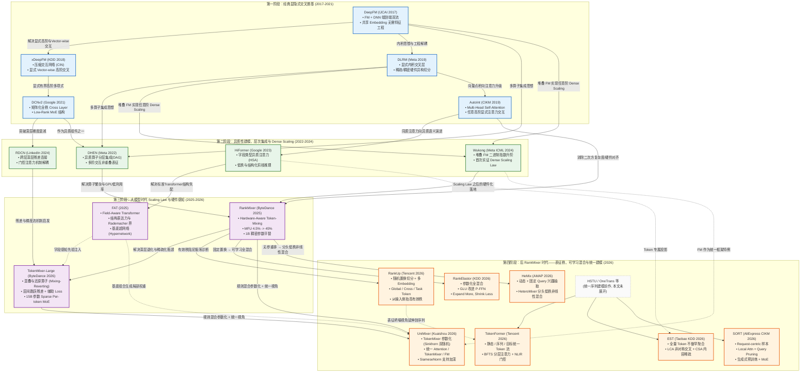

---

### 1.3 十九大核心模型横向对比全景表（含论文直达链接）

| 模型 | 发表年份 / 会议 / 机构 | 论文链接 | 核心交互算子 | 交互层级特征 | 硬件利用率 (MFU) | 核心解决问题 / 创新突破 |
| :--- | :--- | :--- | :--- | :--- | :--- | :--- |
| **DeepFM** | 2017 (IJCAI) <br> 华为 / 中科院 | [arXiv:1703.04247](https://arxiv.org/abs/1703.04247) | FM 二阶内积化简 + MLP | 显式 2 阶 (Vector) + 隐式高阶 (Bit) | 中 | 消除 Wide&Deep 人工特征工程；FM 与 Deep 端到端共享 Embedding。 |
| **xDeepFM**| 2018 (KDD) <br> 中科大 / 微软 | [arXiv:1803.05170](https://arxiv.org/abs/1803.05170) | CIN (压缩交互网络) + MLP | 显式有界高阶 (Vector) + 隐式 (Bit) | 低 (张量外积与卷积计算昂贵) | 首次形式化区分 Bit-wise 与 Vector-wise，实现显式向量级任意高阶交叉。 |
| **DLRM** | 2019 (Meta) | [arXiv:1906.00091](https://arxiv.org/abs/1906.00091) | 向量两两点积 (Dot-Product) | 显式 2 阶 (Vector) + 隐式高阶 (Top MLP) | 中（受限于 Embedding 通信瓶颈） | 规范稀疏与稠密特征解耦并行；点积层提供显式物理交叉先验。 |
| **AutoInt** | 2019 (CIKM) <br> 北京大学 | [arXiv:1810.11921](https://arxiv.org/abs/1810.11921) | Multi-Head Self-Attention + 残差 | 显式任意阶（多层级联扩展，Vector） | 低（自注意力与大量 GEMV 碎片） | 抛弃手工特征组合，利用注意力机制自适应学习高阶特征交互权重。 |
| **DCNv2** | 2021 (WWW) <br> Google | [arXiv:2008.13535](https://arxiv.org/abs/2008.13535) | 矩阵化交叉 $`x_0 \odot (W x_l + b)`$ | 显式有界高阶（ $`L`$ 层代表 $`L+1`$ 阶，Bit） | 中 | 解决 DCN 秩为 1 的表达能力瓶颈，提供全秩矩阵及 Low-Rank MoE 结构。 |
| **RDCN** | 2024 (KDD) <br> LinkedIn | [arXiv:2402.06859](https://arxiv.org/abs/2402.06859) | 残差化 DCN + 门控注意力 | 显式有界多阶交互 + 稠密残差公路 | 中高 | 解决深层 DCN 梯度衰减与信息退化，在百层/深层架构中保持特征有效性。 |
| **DHEN** | 2022 (Meta) | [arXiv:2203.11014](https://arxiv.org/abs/2203.11014) | 多算子层次化集成 (DAG) | 混合阶（显式点积/Cross + 隐式 MLP/Attention） | 较低（流水线并行调度弥补） | 论证单一算子归纳偏置局限，用异质多算子层叠捕获非重叠交叉信息。 |
| **HiFormer** | 2023 (Google Play) | [arXiv:2311.05884](https://arxiv.org/abs/2311.05884) | 异质自注意力 (HSA) + 低秩变换 | 显式任意阶软交互 (字段类型感知) | 中（经结构化剪枝与低秩优化后） | 突破传统 Transformer 同质性假设，显式建模跨字段类型异质交互偏置。 |
| **Wukong** | 2024 (ICML) <br> Meta | [arXiv:2403.02545](https://arxiv.org/abs/2403.02545) | 堆叠 FM (FMB) + 线性压缩 (LCB) | 显式任意阶（第 $`l`$ 层覆盖 $`1 \sim 2^{l}`$ 阶，Vector） | 中高（低秩 FM + 密集 MLP） | 首次在推荐领域实证 Dense Scaling Law；用二进制指数升阶的堆叠 FM 跨越两个数量级算力持续提升质量。 |
| **RankMixer** | 2025 (ByteDance) | [arXiv:2507.15551](https://arxiv.org/abs/2507.15551) | Multi-Head Token-Mixing + Per-Token FFN | 线性跨字段交互 + 维度通道混合 | **极高 (MFU 从 4.5% → 45%)** | 工业级硬件感知设计，彻底淘汰低吞吐碎算子，实现 1B 参数零额外延迟上线。 |
| **FAT** | 2025 (arXiv) | [arXiv:2511.12081](https://arxiv.org/abs/2511.12081) | Field-Aware Transformer + 基底超网络 | 字段级异质全交叉 (结构对齐) | 高（GEMM 密集运算） | 揭示标准 Transformer 在 CTR 上的“结构失配”，用超网络解耦字段参数与模型容量。 |
| **TokenMixer** | 2026 (ByteDance) | [arXiv:2602.06563](https://arxiv.org/abs/2602.06563) | Mixing-and-Reverting + Sparse Per-token MoE | 深度多层非线性拓扑混合 | **极高 (专为 GPU Tensor Core 深度定制)** | 解决深层梯度消失与残差错位，在业内首次稳定扩展至 7B～15B 稠密参数规模。 |
| **RankUp** | 2026 (arXiv) <br> 腾讯（微信广告） | [arXiv:2604.17878](https://arxiv.org/abs/2604.17878) | MetaFormer（Token Mixing + SwiGLU FFN）+ 随机置换切分 / 多 Embedding / Global·Cross·Task Token | 跨 Token 混合 + 通道内非线性；交叉先验以 Token 形式注入 | 23%（线上部署） | 从输入侧缓解表征坍塌，让深层有效秩保持更高；视频号 / 公众号 / 朋友圈广告 GMV +3.41% / +4.81% / +2.12%。 |
| **RankElastor** | 2026 (KDD) <br> 港科大（广州）/ 腾讯 | [arXiv:2605.23191](https://arxiv.org/abs/2605.23191) | 参数化全混合 + GLU 改进 P-FFN | 坐标级全交互（突破块置换的 Kronecker 约束） | 未报告（训练耗时较 RankMixer +10%～15%） | 证明块置换混合只能有界抬秩、普通 FFN 倾向压秩；让表征 “Expand More, Shrink Less”。 |
| **UniMixer** | 2026 (arXiv) <br> 快手 | [arXiv:2604.00590](https://arxiv.org/abs/2604.00590) | UniMixing（全局块混合 × 块内局部混合，Sinkhorn 双随机约束）+ Per-token SwiGLU + SiameseNorm | 可学习全局 + 局部混合；Attention / TokenMixer / FM 均为其特例 | 未报告 | 把规则 TokenMixer 参数化并解除“头数 = Token 数”限制；Lite 版以更少参数获得更陡的 Scaling 曲线，可稳定加深到 8 层。 |
| **HeMix** | 2026 (arXiv) <br> 阿里巴巴 · 高德 | [arXiv:2602.09387](https://arxiv.org/abs/2602.09387) | 动态 + 固定 Query 的异构交叉注意力（序列 Token 化）+ HeteroMixer（分头低秩 MLP 混合）+ HeteroFFN | 线性复杂度的多粒度异构 Token 交互 | 未报告（~100M 规模 1.89 GFLOPs，低于同级 OneTrans 的 2.32） | 同时抽取上下文相关与无关兴趣；同等效果下参数与算力约为 RankMixer 的 1/8；线上 GMV 较 RankMixer +0.88%。 |
| **TokenFormer** | 2026 (arXiv) <br> 腾讯（广告） | [arXiv:2604.13737](https://arxiv.org/abs/2604.13737) | 统一 Token 流上的因果注意力：BFTS（底层全注意力 + 高层收缩滑窗）+ NLIR（Sigmoid 乘性门控） | 字段、序列、目标三类 Token 的六种交互统一在一个骨干内 | 未报告（2F2S 较 4 层全注意力 GFLOPs −20%） | 发现并缓解“序列坍缩传播”；视频号广告 GMV +4.03%。 |
| **EST** | 2026 (KDD) <br> 阿里巴巴 · 淘宝展示广告 | [arXiv:2602.10811](https://arxiv.org/abs/2602.10811) | LCA（非行为 Token 作 Query 读取行为 Token）+ CSA（冻结内容向量 Top-K 相似度稀疏聚合） | 全量原始 Token 统一建模，只保留高信息密度的交叉方向 | 未报告（LCA 较全量自注意力 GFLOPs −72%） | 去掉行为序列的有损早聚合，复杂度从二次降到近线性；“猜你喜欢” CTR +1.22%、RPM +3.27%。 |
| **SORT** | 2026 (CIKM) <br> 阿里巴巴 · AliExpress | [arXiv:2603.03988](https://arxiv.org/abs/2603.03988) | 标准 Transformer + Request-centric 样本 + Local Attention + Query Pruning + QKNorm / Attention Gate + DeepSeek 式 MoE | 历史 / 画像 / 候选统一序列；候选间对角掩码 | 22%（base）/ 45%（large） | 应对高特征稀疏与低标签密度；生成式预训练 + 冻结稀疏 Embedding；线上 GMV +8.65%、延迟 −62%、吞吐 +589%。 |

---

## 二、 特征交叉的核心挑战与问题分类

深入理解上述论文的发展轨迹，必须首先抽象出工业界在构建排序模型时面临的底层共性矛盾。特征交叉的发展史，实际上是学术界与工业界围绕以下六对矛盾不断寻求帕累托最优（Pareto Optimality）的演变过程（前四对贯穿 2017～2025，后两对是 2026 年起的新焦点）：

### 2.1 显式特征交叉 vs 隐式深度表征（Bit-wise vs. Vector-wise）

- **核心矛盾**：
  根据万能逼近定理，多层前馈神经网络（MLP）理论上能拟合任意非线性映射。但在实际高维稀疏样本空间中，梯度下降优化器极难通过普通的加权求和与非线性激活函数（ReLU/GELU）学习到高次乘积形式的交互项（如特征组合 $`x_i x_j`$ 或 $`x_i x_j x_k`$）。
- **学术界证明**：
  Rendle 等人在 2020 年的经典工作 *Neural Collaborative Filtering vs. Matrix Factorization Revisited* 以及 DCNv2 的理论分析中均指出：纯 DNN 拟合二阶点积或高阶点积需要极其庞大的参数量，且泛化性能极度不稳定。
- **Bit-wise vs. Vector-wise 交互粒度区分**：
  - **Bit-wise 交互（元素/位级）**：交互发生在 Embedding 向量内部的具体元素之间（如 DNN、DCN）。即便属于同一字段的向量，各维度也被拆散与其它维线性组合，破坏了字段向量作为一个整体的语义概念；
  - **Vector-wise 交互（向量级）**：交互以完整的 Embedding 向量为基本单位进行内积或哈达玛积（如 FM、xDeepFM 的 CIN、AutoInt、HiFormer）。这保持了字段原生态的语义边界。
- **演进路线**：
  - **显式算子**（Explicit）：将交叉多项式形式固化在算子中（如 DeepFM 的 FM 项、DLRM 的点积、xDeepFM 的 CIN、DCNv2 的矩阵交叉）。
  - **双流并联范式**：显式交叉流（负责记忆高频组合）与隐式深度流（负责低频泛化），二者联合学习。

### 2.2 特征同质性假定 vs 异质性语义先验

- **核心矛盾**：
  在 NLP 领域，输入句子被切分成统一词表下的 Token 序列，所有 Token 属于同质语义空间；而在推荐排序中，输入特征天然由不同**字段（Field）**组成：

```math
\mathrm{Input} = [\mathrm{User\ ID}, \mathrm{Age}, \mathrm{Historical\ Clicks}, \mathrm{Item\ ID}, \mathrm{Category}, \mathrm{Context\ Time}]
```

  不同字段之间具有极强的**语义异质性（Semantic Heterogeneity）**：
  1. $`\text{User ID} \times \text{Item ID}`$ 代表强烈的个性化偏好匹配；
  2. $`\text{Item ID} \times \text{Category}`$ 代表物品内在属性一致性校验；
  3. $`\text{Device OS} \times \text{Network Type}`$ 代表环境统计弱相关。
- **演进路线**：
  - 早期模型（如 AutoInt、Vanilla Transformer）将所有 Field Embedding 平等对待，共享相同的投影矩阵 $`W_Q, W_K`$，强行假设特征交互在统计上是同质的。
  - 中后期模型（DHEN、HiFormer、FAT）提出**异质性显式建模**：
    - DHEN 采用异质多算子分别负责不同类型交互；
    - HiFormer 在注意力矩阵中引入跨 Field 类型的偏置项 $`\mathbf{B}_{\tau_i, \tau_j}`$；
    - FAT 彻底将变换参数字段化（Field-Centric），并通过超网络避免参数量因字段数激增而爆炸。

### 2.3 传统算子低 MFU 瓶颈 vs 硬件感知（Hardware-Aware）计算

- **核心矛盾**：
  从 CPU 集群向大规模 GPU 训推集群迁移的过程中，工业界遭遇了严重的算力浪费。很多精心设计的复杂交叉算子（如高维多项式交叉、图神经网络 FiGNN、树结构特征交叉）其理论计算量 FLOPs 并不高，但实际执行耗时极长，**模型浮点运算利用率（MFU, Model FLOPs Utilization）低至 3%～5%**。
- **根本原因**：
  1. **Memory Bound（内存带宽瓶颈）**：大量逐元素乘法（Element-wise ops）、零碎的 Gather/Scatter 操作、小维度向量点积造成 GPU 流处理器（SM）长期处于等待内存搬运的状态。
  2. **缺少 GEMM 密集算子**：现代 GPU（如 A100/H100/H800）强大的算力来自 Tensor Core 矩阵乘法（GEMM）。如果算法不能组织成大矩阵乘法形式，算力优势完全无法发挥。
- **演进路线**：
  - RankMixer 与 TokenMixer 吹响了“硬件感知模型架构（Hardware-Aligned Architecture）”的号角，果断舍弃零散的内积、手工 Cross 算子，采用高度并行的 Token-Mixing 与 Per-Token MLP，将 MFU 提高至 45% 以上，使得 1B 到 15B 参数模型在严苛延时下具备工程落地可能。

### 2.4 深度扩展（Deep Scaling）与梯度退化问题

- **核心矛盾**：
  在 CV 和 NLP 领域，增加网络层数（从 ResNet-18 到 ResNet-152，从 GPT-2 到 GPT-4）均带来了确定性的性能红利。但在排序模型中，简单的堆叠层数往往迅速导致过拟合或梯度消失。
- **根本原因**：
  推荐系统的表格特征缺乏局部空间相关性或严格的时序因果链，层数增加会导致中间表征信息迅速平滑（Over-smoothing）或者破坏原始稀疏 Embedding 中的专有高频信号。
- **演进路线**：
  - DCNv2 超过 4 层后收益急剧放缓；
  - RDCN 引入跨层 Dense Residual 跳连；
  - Wukong 用残差 + LayerNorm + LCB 保阶，将交互层堆到 8 层仍能随层数捕获更高阶组合，并在内部万亿样本上保持 Scaling 曲线；
  - TokenMixer-Large 提出混合还原机制（Mixing & Reverting）与辅助重构损失，才使得特征交互网络能够在 10 层以上稳定收敛并获得持续的 Scaling 增益；
  - UniMixer 引入 SiameseNorm 双流归一化：在其实验中 RankMixer 从 2 层加到 4 层 AUC 反而下降，UniMixer-Lite 加到 8 层仍持续提升，且加深比加宽更划算。

### 2.5 表征坍塌与有效秩：参数变多不等于表征变丰富

- **核心矛盾**：
  Dense Scaling 增加的是参数量与 FLOPs，但收益最终取决于隐表征能否占用更多有效维度。Guo et al. 在 [*On the Embedding Collapse When Scaling up Recommendation Models*](https://arxiv.org/abs/2310.04400)（ICML 2024）中指出，推荐模型扩容时 Embedding 矩阵会变得近似低秩、出现大量接近 0 的奇异值，即 **Embedding / 表征坍塌（Representation Collapse）**：模型变大了，表示却挤在少数几个方向上。
- **度量方式**：用有效秩（Effective Rank）衡量表征矩阵的维度利用率。各论文口径不同，数值不能直接横向比较：
  - 奇异值熵定义（Roy & Vetterli 2007），RankUp 采用： $`\mathrm{erank}(H) = \exp(-\sum_i p_i \ln p_i)`$，其中 $`p_i = \sigma_i / \sum_j \sigma_j`$；
  - 稳定秩（Stable Rank）定义，RankElastor 采用： $`\mathrm{erank}(X) = \lVert X \rVert_F^{2} / \lVert X \rVert_2^{2}`$；EST 在此基础上再除以 $`\max(m, n)`$ 做归一化。
- **关键观察**：DCNv2、xDeepFM 等传统模型的有效秩随深度单调衰减；RankMixer 呈“混合抬秩、FFN 压秩”的阻尼振荡，略好于传统模型，但没有消除坍塌。
- **演进路线**：
  - RankUp 从输入侧入手：随机置换切分降低 Token 间冗余，多 Embedding 抬高初始秩，再补充全局、交叉、任务三类 Token；
  - RankElastor 从结构侧入手：证明块置换混合只能有界抬秩、普通 FFN 倾向压秩，改用可学习全混合与 GLU FFN；
  - TokenFormer 把这一视角延伸到序列建模：低秩静态特征会把序列表征一起拖向坍缩，用分层注意力范围与乘性门控缓解。

### 2.6 序列与非序列统一建模：信息密度不对称

- **核心矛盾**：
  经典做法是“特征交叉网络 + 序列模块”的异构流水线：DIN、SIM 等先把行为序列聚合成少量向量，再与非序列特征交叉。这种早聚合高效，但丢掉了 Token 级细粒度信息，限制了 Scaling 收益。最直接的替代是把用户画像、候选特征、行为序列全部拼成一个 Token 序列，用 Transformer 统一建模，但会遇到三个问题：
  1. **算力**：全量自注意力复杂度为 $`O((L_N + L_B)^{2} d)`$，行为序列动辄数百上千，而非行为 Token 只有几十个；
  2. **交互价值不均**：EST 发现“非行为 Token 读取行为 Token”这一块注意力信息量最高，其余块（行为之间、行为读非行为、非行为之间）掩掉几乎不掉点；
  3. **坍缩传播与监督稀疏**：TokenFormer 发现低秩静态 Token 会拖垮序列表征；SORT 指出序列占输入的大部分却没有直接监督，稀疏的二值标签难以约束海量参数。
- **演进路线**：三篇代表作都承认“信息密度不对称”，但选择在不同维度上做稀疏：
  - TokenFormer **按层**控制：底层全注意力完成跨类型融合，高层收缩滑窗并丢弃静态 Token；
  - EST **按 Token 类型**控制：只保留“非行为 → 行为”的交叉，行为内部用冻结内容相似度做 Top-K 稀疏聚合；
  - SORT **按时间位置**控制：历史 Token 用局部注意力，逐层剪掉远离候选的 Query，并用生成式预训练补足标签密度；
  - HeMix 则是“部分统一”的代表：先用动态 + 固定 Query 把长短期序列压成数十个兴趣 Token，再用线性复杂度的混合块交互。

---

## 三、 十九大核心模型逐一深度拆解

```
═══════════════════════════════════════════════════════════════════════════════════════
                     十九大核心推荐排序模型演进树（2017-2025 主干）
═══════════════════════════════════════════════════════════════════════════════════════
 2017        2018         2019            2021            2022       2023   2024   2025   2026
 ────        ────         ────            ────            ────       ────   ────   ────   ────
 DeepFM ───► xDeepFM
   │
   ├────────────────────► DLRM ──────────┐────────────────────────► Wukong
   │                                     │                      (Stacked FM Scaling)
   └────────────────────► AutoInt ───────┼────────────────────────► HiFormer ────────► FAT
                                         │                                              ▲
                          DCNv2 ─────────┴──────────────► DHEN ─────┐                   │
                            └───────────────────────────────────────┴──► RDCN           │
                                                                           │            │
                                                    Wukong & RDCN ─────────┴──► RankMixer ──► TokenMixer
                                                                               (Hardware-Aware)  (15B)
═══════════════════════════════════════════════════════════════════════════════════════
                         2026 后 RankMixer 时代分支
═══════════════════════════════════════════════════════════════════════════════════════
 RankMixer ─┬─► TokenMixer-Large   (混合-还原, 15B)
            ├─► RankUp             (输入侧抬高有效秩) ─ ─ ─► TokenFormer (序列坍缩传播)
            ├─► RankElastor        (可学习全混合 + GLU FFN)
            ├─► UniMixer           (参数化 TokenMixer, 统一 Attention / TokenMixer / FM)
            └─► HeMix              (分头低秩非线性混合 + 混合 Query 兴趣抽取)

 HSTU / OneTrans ──► TokenFormer / EST / SORT   (序列 + 非序列统一 Transformer)
═══════════════════════════════════════════════════════════════════════════════════════
```

---

### 3.1 DeepFM：端到端双流特征交叉与共享 Embedding 的奠基者

- **论文标题**：[*DeepFM: A Factorization-Machine based Neural Network for CTR Prediction*](https://arxiv.org/abs/1703.04247)
- **发表出处**：IJCAI 2017
- **机构作者**：华为诺亚方舟实验室、中国科学院（Huifeng Guo, Ruiming Tang, Yunming Ye, Zhenguo Li, Xiuqiang He）

#### 背景与痛点分析
在此之前，Google 的 Wide&Deep 框架是工业界最炙手可热的架构。然而，Wide&Deep 存在一个致命的工程痛点：**Wide 部分依赖大规模人工特征工程（Cross-Product Feature Transformations）**。工程师必须凭借业务经验，手动挑选哪些特征需要做交叉组合（例如 `AND(user_installed_app='Netflix', item_impression='Hulu')`）。这不仅带来了高昂的人力与试错成本，而且无法发现训练集之外未见过的新型特征组合。

#### 核心网络结构与推导

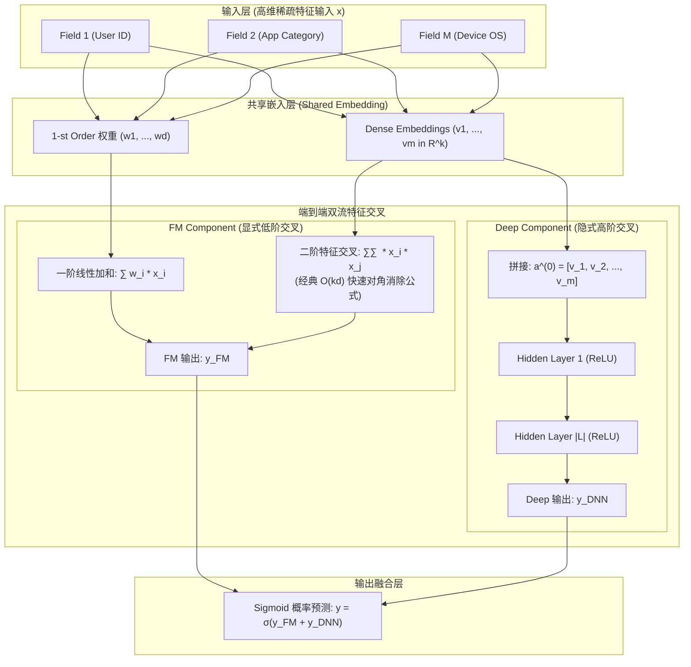

#### (1) 共享 Embedding 机制（Shared Embeddings）
DeepFM 的核心突破在于：**FM 组件与 Deep 组件完全共享底层的特征嵌入向量（Embedding Vectors）**。
对于每个稀疏 Field $`i`$，其离散值映射为连续低维稠密向量 $`v_i \in \mathbb{R}^k`$。该向量同时服务于两条路径：
- 在 FM 组件中充当潜在因子（Latent Vector）计算特征内积；
- 在 Deep 组件中作为多层感知机的输入输入前馈网络。

**双重梯度回传（Dual Gradient Propagation）**：梯度同时从低阶显式路径和高阶隐式路径反向传播，使得 Embedding 能够兼顾记忆性（Memorization）与泛化性（Generalization），无需任何特征预训练。

#### (2) FM 组件数学推导与计算优化
FM 部分包含一阶线性项与二阶交叉项：

```math
y_{\mathrm{FM}} = \langle w, x \rangle + \sum_{i=1}^d \sum_{j=i+1}^d \langle v_i, v_j \rangle x_i x_j
```

直接计算两两特征向量内积的复杂度为 $`O(k \cdot d^2)`$。Rendle 提出的经典化简技巧将两两点积和转化为多项式差值，计算复杂度直接降为 $`O(k \cdot d)`$。

**推导步骤 1（对称阵分解）**：将严格上三角矩阵求和转化为全对称矩阵求和减去对角线自身内积后除以 2：

```math
\sum_{i=1}^d \sum_{j=i+1}^d \langle v_i, v_j \rangle x_i x_j = \frac{1}{2} \left( \sum_{i=1}^d \sum_{j=1}^d \langle v_i, v_j \rangle x_i x_j - \sum_{i=1}^d \langle v_i, v_i \rangle x_i x_i \right)
```

**推导步骤 2（代入内积定义并交换求和次序）**：代入点积展开式 $`\langle v_i, v_j \rangle = \sum_{f=1}^k v_{i,f} v_{j,f}`$，将隐藏因子维度 $`f`$ 提到最外层：

```math
= \frac{1}{2} \sum_{f=1}^k \left[ \left( \sum_{i=1}^d v_{i,f} x_i \right) \left( \sum_{j=1}^d v_{j,f} x_j \right) - \sum_{i=1}^d v_{i,f}^2 x_i^2 \right]
```

**推导步骤 3（合并全集求和为平方项）**：由于两项是对同一全集的求和，直接化简为单重求和平方差：

```math
= \frac{1}{2} \sum_{f=1}^k \left[ \left( \sum_{i=1}^d v_{i,f} x_i \right)^2 - \sum_{i=1}^d v_{i,f}^2 x_i^2 \right]
```

#### (3) Deep 组件与最终预测
将所有活跃字段的嵌入向量拼接作为网络底层输入：

```math
a^{(0)} = [v_1, v_2, \dots, v_m] \in \mathbb{R}^{m \cdot k}
```

经过多层非线性全连接前馈传播：

```math
a^{(l+1)} = \mathrm{ReLU}\left( W^{(l)} a^{(l)} + b^{(l)} \right)
```

```math
y_{\mathrm{DNN}} = W^{(|L|+1)} a^{(|L|)} + b^{(|L|+1)}
```

最终点击率预测通过 Sigmoid 激活函数联合输出：

```math
\hat{y} = \sigma\left( y_{\mathrm{FM}} + y_{\mathrm{DNN}} \right)
```

#### 核心贡献与工业反思
- **里程碑意义**：DeepFM 彻底终结了手工组合特征的时代，成为了近十年工业界落地范围最广、最经典的“黄金基线（Golden Baseline）”之一。
- **历史局限性**：
  1. FM 组件仅能处理严格的**二阶**交叉；
  2. 超过二阶的高阶特征交互全部丢给了 Deep 组件（MLP），而正如前文所述，MLP 进行的是隐式、Bit-wise 交叉，无法精准控制高阶特征交互的形式。

---

### 3.2 xDeepFM：Vector-wise 显式高阶压缩交互网络 (CIN)

- **论文标题**：[*xDeepFM: Combining Explicit and Implicit Feature Interactions for Recommender Systems*](https://arxiv.org/abs/1803.05170)
- **发表出处**：ACM SIGKDD 2018
- **机构作者**：中国科学技术大学、微软亚洲研究院（Jianxun Lian, Xiaohuan Zhou, Fuzheng Zhang, Zhongxia Chen, Xing Xie, Guangzhong Sun）

#### 背景与理论洞察：Bit-wise vs. Vector-wise
作者提出了推荐系统特征交叉领域最深刻的理论分野之一：**位级（Bit-wise）交叉与向量级（Vector-wise）交叉的区别**：
- **Bit-wise 隐式交互**：在传统 DNN 和早期的 DCN 中，特征 Embedding 在输入隐藏层前往往被展平（Flatten）。由于矩阵乘法的加权求和机制，来自同一个 Field 内部的不同分量（bits）与其它 Field 内部的不同分量发生混合。这种交互破坏了“一个 Field 作为一个整体语义向量”的物理先验；
- **Vector-wise 显式交互**：因子分解机（FM）的核心优势在于特征交互是向量级别的（即通过内积 $`\langle v_i, v_j \rangle`$ 交互，输出一个代表整体相关性的标量）。

针对以往深度模型（DeepFM、DCN 等）无法以 **Vector-wise** 形式显式捕获**任意有界高阶**交互的缺陷，xDeepFM 提出了革命性的 **CIN (Compressed Interaction Network，压缩交互网络)**。

#### 核心网络结构：CIN 的数学推导与架构图

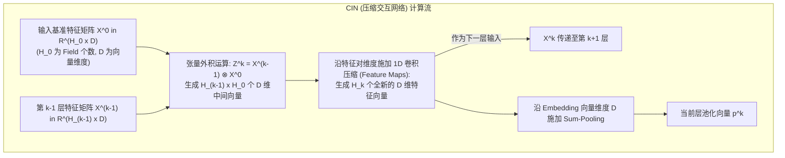

CIN 的计算过程酷似卷积神经网络（CNN），但专门作用于特征字段矩阵：
设第 $`k`$ 层的特征矩阵为：

```math
X^k \in \mathbb{R}^{H_k \times D}
```

其中 $`H_k`$ 表示该层拥有的特征向量个数（初始第 0 层 $`H_0 = m`$ 为原始字段数）， $`D`$ 为 Embedding 维度。

#### (1) 张量外积与特征逐元素乘法（Hadamard Product）
在第 $`k`$ 层，CIN 将当前层状态 $`X^{k-1}`$ 与最原始的输入状态 $`X^0`$ 进行跨字段外积交互。中间状态张量 $`Z^k \in \mathbb{R}^{H_{k-1} \times H_0 \times D}`$ 的每个分量计算如下：

```math
Z_{i,j, \cdot}^k = X_{i, \cdot}^{k-1} \odot X_{j, \cdot}^0, \quad 1 \le i \le H_{k-1}, \; 1 \le j \le H_0
```

这里 $`\odot`$ 代表向量维度的逐元素乘法。这一步显式构成了第 $`k`$ 阶特征组合，且严格保持了向量级别（Vector-wise）的对齐。

#### (2) 特征图卷积压缩（Feature Maps Compression）
为控制参数量并提取关键交互模式，CIN 引入 $`H_k`$ 个卷积核矩阵：

```math
W^{k,h} \in \mathbb{R}^{H_{k-1} \times H_0}, \quad 1 \le h \le H_k
```

每个卷积核将高维张量 $`Z^k`$ 在特征对维度进行加权压缩求和，生成第 $`k`$ 层的第 $`h`$ 个特征向量：

```math
X_{h, \cdot}^k = \sum_{i=1}^{H_{k-1}} \sum_{j=1}^{H_0} W_{i,j}^{k,h} Z_{i,j, \cdot}^k \in \mathbb{R}^D
```

此时矩阵 $`X^k \in \mathbb{R}^{H_k \times D}`$ 构成了第 $`k`$ 层的输出。

#### (3) 多尺度求和池化（Sum-Pooling）与预测
与传统的仅用最后一层输出不同，CIN 效仿多尺度特征融合，在每一层均对特征向量进行沿维度 $`D`$ 的求和池化：

```math
p_i^k = \sum_{d=1}^D X_{i,d}^k, \quad 1 \le i \le H_k
```

将所有层级的池化向量级联拼接成多阶汇总向量：

```math
p^+ = [p^1, p^2, \dots, p^K] \in \mathbb{R}^{\sum_{k=1}^K H_k}
```

xDeepFM 最终将 **Linear 线性项、Plain DNN 隐式项以及 CIN 显式高阶向量项** 联合加权输出：

```math
\hat{y} = \sigma\left( w_{\mathrm{linear}}^T x + w_{\mathrm{dnn}}^T a^{(|L|)} + w_{\mathrm{cin}}^T p^+ \right)
```

#### 核心贡献与工业反思
- **理论高度**：xDeepFM 首次实现了：① 显式特征交叉；② 严格 Vector-wise 向量级；③ 交互阶数随网络层数线性可控增长；④ 参数不随输入序列长度无限爆炸。
- **工程落地阻碍**：
  CIN 中的张量外积与特征图 1D 卷积操作的时间与空间复杂度高达：

```math
O\left( \sum_{k=1}^K H_k H_{k-1} H_0 D \right)
```

  当工业界特征字段数 $`H_0`$ 超过 100 时，中间张量 $`Z^k`$ 的显存占用和卷积延迟极其庞大，导致 xDeepFM 在超大工业在线推荐中极难满足几毫秒的极限 SLA 要求。这也直接催生了后序研究对低秩化、矩阵化（DCNv2）以及硬件亲和性（RankMixer）的探索。

---

### 3.3 DLRM：工业级稀疏与稠密特征解耦的奠基石

- **论文标题**：[*Deep Learning Recommendation Model for Personalization and Recommendation Systems*](https://arxiv.org/abs/1906.00091)
- **发表出处**：arXiv 2019
- **机构作者**：Facebook (现 Meta)（Maxim Naumov 等）

#### 背景与动机
2019 年，Facebook 提出了 **DLRM (Deep Learning Recommendation Model)**。当时工业界存在 DeepFM、Wide&Deep 等方案，但缺乏一个在系统硬件架构与模型结构上完全协同的工业基准。DLRM 明确了大规模推荐系统的双重属性：**处理稀疏 Categorical 特征的内存密集型任务**，与**处理稠密 Continuous 特征的算力密集型任务**。

#### 核心网络结构与推导

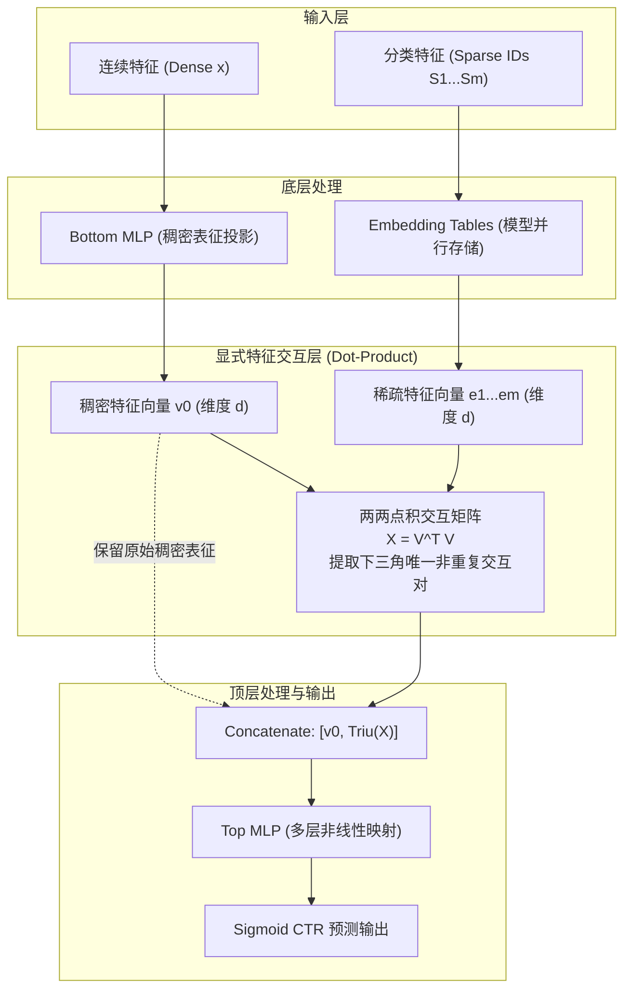

#### (1) 底层映射（Bottom Representation）
- 连续特征 $`x \in \mathbb{R}^C`$ 通过 Bottom MLP 映射到与稀疏嵌入相同的隐藏空间维度 $`d`$：

```math
v_0 = \mathrm{MLP}_{\mathrm{bottom}}(x) \in \mathbb{R}^d
```

- $`M`$ 个稀疏类别特征查表得到 $`M`$ 个 $`d`$ 维嵌入向量：

```math
v_i = \mathrm{EmbeddingLookUp}(S_i) \in \mathbb{R}^d, \quad i \in \lbrace 1, 2, \dots, M \rbrace
```

#### (2) 显式点积交互层（Dot-Product Interaction）
将所有表征拼接成矩阵 $`V = [v_0, v_1, v_2, \dots, v_M] \in \mathbb{R}^{d \times (M+1)}`$。两两之间计算点积生成对称相关性矩阵 $`A \in \mathbb{R}^{(M+1) \times (M+1)}`$：

```math
A = V^T V, \quad A_{i,j} = \langle v_i, v_j \rangle = v_i^T v_j
```

由于 $`A_{i,i}`$ 为自身内积且 $`A_{i,j} = A_{j,i}`$，DLRM 提取严格下三角的所有非重复项作为显式二阶交叉特征：

```math
f_{\mathrm{inter}} = [v_i^T v_j]_{0 \le j \lt i \le M} \in \mathbb{R}^{\frac{M(M+1)}{2}}
```

#### (3) 顶层预测（Top MLP）
将原始稠密特征向量 $`v_0`$ 与所有二阶交叉项拼接，输入 Top MLP 进行非线性抽象与概率回归：

```math
\hat{y} = \sigma\left( \mathrm{MLP}_{\mathrm{top}}\left( [v_0^T, f_{\mathrm{inter}}^T]^T \right) \right)
```

#### 核心贡献与系统创新
- **混合并行系统架构（Hybrid Parallelism）**：Embedding 占用数百 GB 显存，采用**模型并行（Model Parallelism）**分布在多张 GPU 卡上；MLP 与交互层计算密集，采用**数据并行（Data Parallelism）**。两者之间通过高效的 All-to-All 集合通信原语连接。
- **纯粹简洁的物理先验**：放弃复杂的无序连接，用纯粹的点积矩阵提取二阶相关性，成为工业推荐最坚实的 baseline。

---

### 3.4 AutoInt：基于自注意力机制的任意阶显式交叉

- **论文标题**：[*AutoInt: Automatic Feature Interaction Learning via Self-Attentive Neural Networks*](https://arxiv.org/abs/1810.11921)
- **发表出处**：ACM CIKM 2019
- **机构作者**：北京大学（Weiping Song, Chence Shi, Zhiping Xiao, Zhijian Duan, Yewen Xu, Ming Zhang, Jian Tang）

#### 背景与动机
AutoInt 针对已有模型（FM 局限在 2 阶、DCN 组合受限、DeepFM 依赖隐式 DNN）的短板，首次将 Transformer 的 Multi-Head Self-Attention (MHSA) 机制引入表格特征交互，旨在**自动映射与学习任意阶高阶特征交叉**，且无需任何手工规则。

#### 核心网络结构与数学推导
设输入包含 $`M`$ 个特征字段（Field），每个字段映射为固定长度 $`d`$ 的嵌入向量 $`e_i \in \mathbb{R}^d`$。

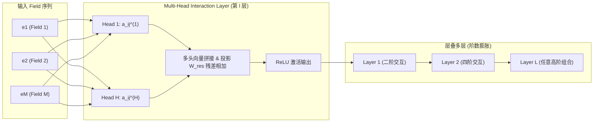

#### (1) 交互亲和度（Attention Weights）
在第 $`m`$ 个注意力头中，字段 $`i`$ 与字段 $`j`$ 的显式交互强度由下式计算：

```math
\alpha_{i,j}^{(m)} = \frac{\exp\left( \psi^{(m)}(e_i, e_j) \right)}{\sum_{k=1}^M \exp\left( \psi^{(m)}(e_i, e_k) \right)}
```

其中非对称交互打分函数定义为：

```math
\psi^{(m)}(e_i, e_j) = \frac{\langle W_Q^{(m)} e_i, W_K^{(m)} e_j \rangle}{\sqrt{d'}}
```

其中 $`W_Q^{(m)}, W_K^{(m)} \in \mathbb{R}^{d' \times d}`$ 分别为 Query 和 Key 投影矩阵， $`d'`$ 为单头维度。

#### (2) 特征聚合与多头融合
字段 $`i`$ 汇聚所有其他字段在其投影子空间下的信息：

```math
z_i^{(m)} = \sum_{j=1}^M \alpha_{i,j}^{(m)} \left( W_V^{(m)} e_j \right)
```

将 $`H`$ 个头的表征进行拼接并施加残差连接以保留原始阶数信息：

```math
z_i = \mathrm{Concat}\left( z_i^{(1)}, z_i^{(2)}, \dots, z_i^{(H)} \right) \in \mathbb{R}^{H d'}
```

```math
e_i^{(l+1)} = \mathrm{ReLU}\left( z_i + W_{\mathrm{res}} e_i^{(l)} \right)
```

#### (3) 高阶组合原理
- 1 层注意力交互捕获 2 阶特征组合；
- 2 层注意力交互可将已聚合的 2 阶组合再次聚合，从而形成 4 阶及更高阶特征组合；
- 注意力系数 $`\alpha_{i,j}`$ 直观揭示了哪些字段组合对最终预估贡献最大，具备极强的**模型可解释性**。

#### 局限性与工业反思
虽然 AutoInt 在学术基准上大幅领先，但在工业界落地极其艰难：
- 计算复杂度高达 $`O(L \cdot M^2 d)`$，当工业特征字段 $`M \gt 200`$ 时，自注意力矩阵计算与 Softmax 成为线上推理延时的重大杀手；
- 假定所有字段的 Query/Key 映射均在同一个全局投影参数矩阵下完成，忽略了推荐特征极其强烈的字段异质性。

---

### 3.5 DCNv2：突破低秩瓶颈的张量化显式特征交叉网络

- **论文标题**：[*DCN V2: Improved Deep & Cross Network and Practical Lessons for Web-scale Learning to Rank Systems*](https://arxiv.org/abs/2008.13535)
- **发表出处**：The Web Conference (WWW) 2021
- **机构作者**：Google（Ruoxi Wang, Rakesh Shivanna, Derek Cheng, Sagar Jain, Dong Lin, Lichan Hong, Ed Chi）

#### 背景与痛点分析
Google 团队在 2021 年发表的 **DCNv2** 中指出：**DCNv1 的 Cross Network 存在严重的表达能力瓶颈（Low-Rank Bottleneck）**。
在 DCNv1 中，第 $`l+1`$ 层的交叉公式为：

```math
x_{l+1} = x_0 x_l^T w_l + b_l + x_l
```

项 $`x_0 x_l^T w_l = x_0 (x_l^T w_l)`$ 中， $`(x_l^T w_l)`$ 是一个**标量（Scalar）**。输出向量 $`x_{l+1} - x_l`$ 永远只是输入向量 $`x_0`$ 的标量缩放倍数，张量积矩阵的秩严格等于 1。这极大地限制了模型拟合复杂特征非线性交互的能力。

#### DCNv2 核心数学推导与架构

DCNv2 将交叉项中的权重向量直接升级为**全秩权重矩阵（Full-Rank Matrix）**，并结合逐元素哈达玛积（Hadamard product）：

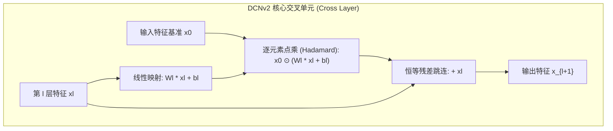

公式表达为：

```math
x_{l+1} = x_0 \odot \left( W_l x_l + b_l \right) + x_l
```

其中 $`x_0, x_l \in \mathbb{R}^D`$ ， $`W_l \in \mathbb{R}^{D \times D}`$ 为完全可学习的高维权重参数矩阵，$`\odot`$ 表示逐元素乘法。每一维特征均可与 $`x_0`$ 发生独立加权的二阶交叉。

#### 工程落地挑战与 Low-Rank MoE 创新
由于特征总维度 $`D`$ 往往高达数千， $`W_l \in \mathbb{R}^{D \times D}`$ 的参数量和计算复杂度为 $`O(D^2)`$，在线推理极其昂贵。为此，DCNv2 提出了两项绝妙工程改进：

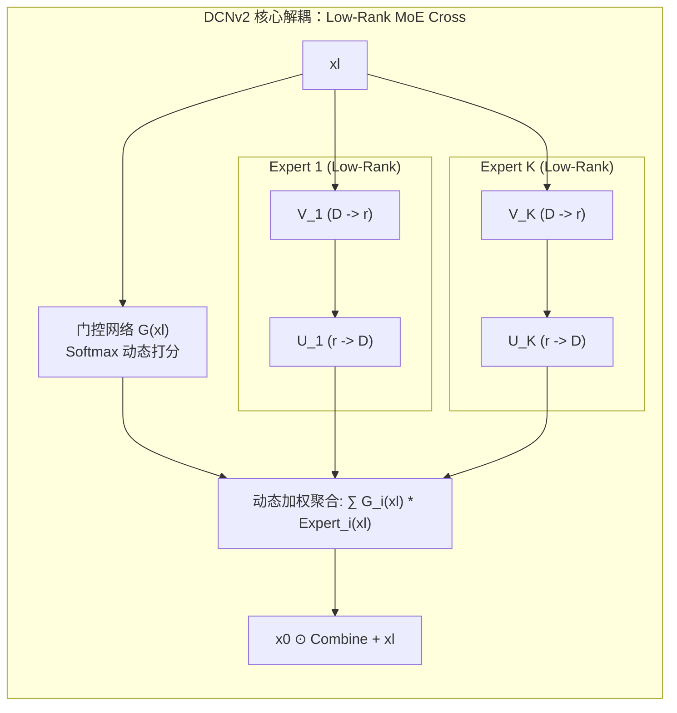

#### (1) 低秩分解（Low-Rank Factorization）
利用矩阵低秩分解将 $`W_l`$ 拆解为两个细长矩阵的乘积：

```math
W_l = U_l V_l^T, \quad U_l, V_l \in \mathbb{R}^{D \times r}, \quad r \ll D
```

计算过程转化为：

```math
W_l x_l = U_l \left( V_l^T x_l \right)
```

将计算复杂度从 $`O(D^2)`$ 瞬间降为 $`O(2 D r)`$。

#### (2) 混合专家低秩交叉（Mixture of Low-Rank Cross Experts）
为了用低计算量弥补低秩带来的容量削弱，DCNv2 结合 MoE 思想，并行部署 $`K`$ 个低秩专家，并通过门控网络动态选择：

```math
x_{l+1} = \sum_{i=1}^K G_i(x_l) \left( x_0 \odot \left( U_{l,i} \left( V_{l,i}^T x_l \right) + b_l \right) \right) + x_l
```

其中 $`G(x_l) = \mathrm{Softmax}(W_g x_l) \in \mathbb{R}^{K}`$。

---

### 3.6 RDCN：深层交叉网络退化破解与残差注意力强化

- **论文标题**：[*LiRank: Industrial Large Scale Ranking Models at LinkedIn*](https://arxiv.org/abs/2402.06859)
- **发表出处**：ACM SIGKDD 2024
- **机构作者**：LinkedIn（Fedor Borisyuk, Mingzhou Zhou, Qingquan Song, Siyu Zhu 等）

#### 背景与痛点分析
在 LinkedIn 大规模排序架构 **LiRank** 的生产落地实践中，算法团队发现：尽管 DCNv2 在 2～4 层时表现亮眼，但当工程师尝试将 Cross 层堆叠得更深（例如 8～16 层甚至更高）时，模型出现了**严重的收益饱和甚至性能大幅衰减**。
核心原因在于：
1. 每一层 Cross Layer 均强制注入初始输入 $`x_0`$，高层特征的梯度在回传至浅层时面临严重的数值弥散与路径阻断；
2. 固定的跳跃残差无法根据样本输入自适应控制深层特征与原始特征的信息吞吐配比。

#### RDCN (Residual DCN) 架构机制与数学表达
针对上述退化问题，LinkedIn 提出了 **RDCN (Residual DCN)**，在 DCNv2 的骨干之上进行了三重关键拓扑升级：

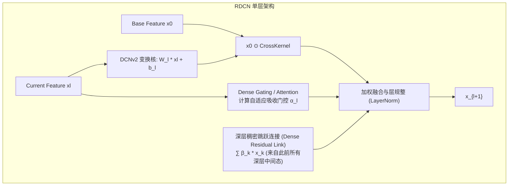

#### (1) 门控稠密注意力机制（Dense Gating Mechanism）
引入自注意力门控向量对交叉信号进行通道级重要性重新校准：

```math
g_l = \sigma\left( W_{\mathrm{gate}}^{(l)} x_l + b_{\mathrm{gate}}^{(l)} \right)
```

```math
\tilde{x}_{l} = g_l \odot \left( x_0 \odot (W_l x_l + b_l) \right)
```

#### (2) 跨层全连接残差跳连（Multi-Scale Residual Highway）
RDCN 引入受 DenseNet 启发的深层残差公路，将所有先验历史层的信息作为跳连候选集：

```math
x_{l+1} = \tilde{x}_l + \sum_{k=0}^l \gamma_{k,l} x_k
```

其中 $`\gamma_{k,l}`$ 为可学习或动态计算的层间注意力权重。这使得高阶交叉梯度可以无损、短程直达底层 Embedding，彻底打破深层 Cross 网络的退化诅咒。

---

### 3.7 DHEN：异质交叉多算子层次化集成的先驱

- **论文标题**：[*DHEN: A Deep and Hierarchical Ensemble Network for Large-Scale Click-Through Rate Prediction*](https://arxiv.org/abs/2203.11014)
- **发表出处**：arXiv 2022 / Meta 生产架构
- **机构作者**：Meta（Buyun Zhang, Liang Luo, Yuxin Chen 等）

#### 背景与动机
2022 年，Meta 在其广告 CTR 预估系统研发中提出了 **DHEN**。Meta 研究人员发现：工业界涌现了大量特征交叉结构（如 DLRM 的 Dot-Product、DCN 的多项式外积、AutoInt 的自注意力、FM 的二阶因子分解、Wide 的线性偏置）。
在大规模真实数据集上的横向评测显示：**即使声称能捕捉相同阶数交互的两个模型，它们在不同数据集上的优劣表现也截然相反，没有任何一个单一架构能在所有场景下保持统治力**。这表明：**不同交互算子具备完全非重叠的归纳偏置（Non-overlapping Inductive Biases）与信息捕获盲区**。

#### 核心网络结构：有向无环图（DAG）分层集成
DHEN 不再试图设计某种“万能单一算子”，而是提出了一种结构宏大的层次化集成网络：

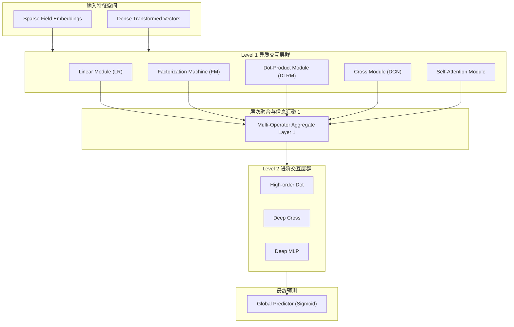

#### (1) 异质模块库（Heterogeneous Module Zoo）
DHEN 在每一层部署一个异质模块集合 $`\mathcal{M} = \lbrace M_1, M_2, \dots, M_K \rbrace`$，包括：
- **线性流（Linear/LR）**：捕捉原始特征独立显著性；
- **因子分解流（FM）**：无参数计算特征对内积；
- **点积流（Dot-Product）**：全通道两两向量点乘；
- **张量交叉流（Cross Network）**：受控阶数有界多项式映射；
- **自注意力流（Self-Attention）**：自适应软寻址交互；
- **非线性深层前馈流（MLP）**：全连接隐式非线性空间投影。

#### (2) 深层层次化堆叠（Hierarchical Stacking）
第 $`l+1`$ 层各个模块以先前所有层的组合状态作为输入：

```math
H^{(l+1)} = \mathrm{Concat}\left( \left\lbrace M_k^{(l+1)}\left( [H^{(0)}, H^{(1)}, \dots, H^{(l)}] \right) \right\rbrace_{k=1}^K \right)
```

通过将不同算子在时间与空间维度组织为类似 DAG 的分层流动，低阶交互在底层形成基石，高阶混合交互在顶层自然涌现。

#### 系统软硬件协同设计（Co-Design）
DHEN 深度极大，结构异构，Meta 专门研发了**层次流水线并行（Hierarchical Pipelined Training System）**：
- 显式将计算无依赖的子算子（如同层的 FM 与 Dot-Product）切分到不同 CUDA Stream 异步并发发射；
- 对长反向传播链路应用定制的激活值重计算（Activation Checkpointing）与权重分级流水线，使 DHEN 在取得 0.27% Normalized Entropy (NE) 商业提升的同时，训练吞吐量反而提升了 1.2 倍。

---

### 3.8 HiFormer：跨字段异质性自注意力与低秩压缩

- **论文标题**：[*Hiformer: Heterogeneous Feature Interactions Learning with Transformers for Recommender Systems*](https://arxiv.org/abs/2311.05884)
- **发表出处**：arXiv 2023 / Google Play 生产落地
- **机构作者**：Google（Guanjie Gui 等）

#### 背景与动机
Google 团队直击 Transformer 在工业推荐落地的第一大痛点：**标准自注意力将所有字段 token 一视同仁，完全抹杀了字段异质性（Heterogeneity）**。
例如在 Google Play 场景下：
- `(User_Installed_Apps, Target_App)` 的注意力关注“相关性推导”；
- `(Target_App, App_Category)` 的注意力关注“属性归属判定”；
- `(User_Network_Type, App_Size)` 的注意力关注“下载环境阻力”。
标准 Transformer 用一组统一的 $`W_Q, W_K`$ 强行映射所有关系，导致模型表达能力大打折扣。

#### 异质自注意力机制（Heterogeneous Self-Attention, HSA）
HiFormer 提出了颠覆性的**异质自注意力层（HSA Layer）**：

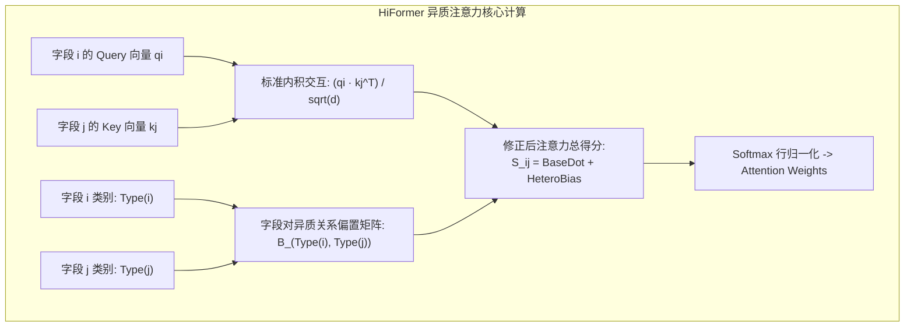

#### (1) 类型感知注意力标量计算
设共有 $`M`$ 个特征字段，字段 $`i`$ 具备属性类别 $`\tau_i \in \lbrace 1, 2, \dots, C \rbrace`$。两个字段 $`i`$ 与 $`j`$ 的注意力打分公式被重构为：

```math
\mathrm{Score}(i, j) = \frac{\langle W_Q e_i, W_K e_j \rangle}{\sqrt{d}} + \mathbf{B}_{\tau_i, \tau_j}
```

其中 $`\mathbf{B} \in \mathbb{R}^{C \times C}`$ 是一个可学习的**字段类型关系偏置矩阵（Type-Pair Bias Matrix）**，为不同语义域之间的交互注入了强烈的归纳先验。

#### (2) 字段感知投影拓展（Field-Aware Projections）
在更强版本中，投影矩阵本身与字段类型绑定：

```math
\mathrm{Score}(i, j) = \frac{e_i^T \left( W_Q^{(\tau_i) T} W_K^{(\tau_j)} \right) e_j}{\sqrt{d}} + \mathbf{B}_{\tau_i, \tau_j}
```

允许不同语义实体在独立的流形子空间中度量相似度。

#### 工业极速推理优化：低秩与结构化剪枝
针对 Google Play 对 P99 延迟的极致要求，HiFormer 提出了两套工程降耗组合拳：
- **Projection 低秩分解**：将 $`W_Q, W_K \in \mathbb{R}^{d \times d}`$ 压缩为高细比矩阵乘积 $`U V^T`$（秩 $`r \ll d`$）；
- **注意力稀疏剪枝（Attention Head Pruning）**：通过可微掩码评估不同头的重要性，上线前剪除多达 50% 贡献微弱的交互头，在 Google Play 线上模型中提升关键指标（+2.66% 转化），且延迟符合生产 SLA。

---

### 3.9 Wukong：堆叠因子分解机与推荐领域 Scaling Law

- **论文标题**：[*Wukong: Towards a Scaling Law for Large-Scale Recommendation*](https://arxiv.org/abs/2403.02545)
- **发表出处**：ICML 2024
- **机构作者**：Meta AI（Buyun Zhang, Liang Luo, Yuxin Chen 等，Zhang 与 Luo 为共同一作）

#### 背景与动机：Sparse Scaling 的穷途
工业推荐长期把“做大模型”理解成**扩张 Embedding 表**（更多行、更高维），稀疏参数轻松堆到万亿级。Wukong 指出这条 Sparse Scaling 路线有三个结构性缺陷：
1. **交互能力并不随参数增长**：Embedding 表变大只降低哈希碰撞，并不能让模型学到更高阶、更复杂的特征组合；
2. **与硬件演进错位**：下一代加速器的红利几乎全部来自计算吞吐，Embedding Lookup 吃不到 Tensor Core；
3. **已有交互架构难以 Dense Scaling**：DLRM 交互层过浅，DCNv2 / AutoInt+ 放大后收益迅速饱和，即便加上残差、LayerNorm 与梯度裁剪，放大时仍频繁出现训练不稳定。

因此 Wukong 把目标明确为：找到一套**统一交互骨干**，让质量能够随数据规模、单样本算力（GFLOP/example）与稠密参数预算协同提升——也就是在推荐领域建立类似 LLM 的 Scaling Law。

#### 核心思想：用堆叠 FM 做二进制指数升阶
Wukong 的交互栈受到**二进制幂运算（Binary Exponentiation）**启发：每一层只对输入做二阶交叉，再把交叉结果变成下一层的新 Embedding。于是第 $`i`$ 层自然覆盖 $`1`$ 到 $`2^{i}`$ 阶交互——加深一层，最高阶数翻倍，而不是像 HOFM / CIN 那样按层线性加阶。

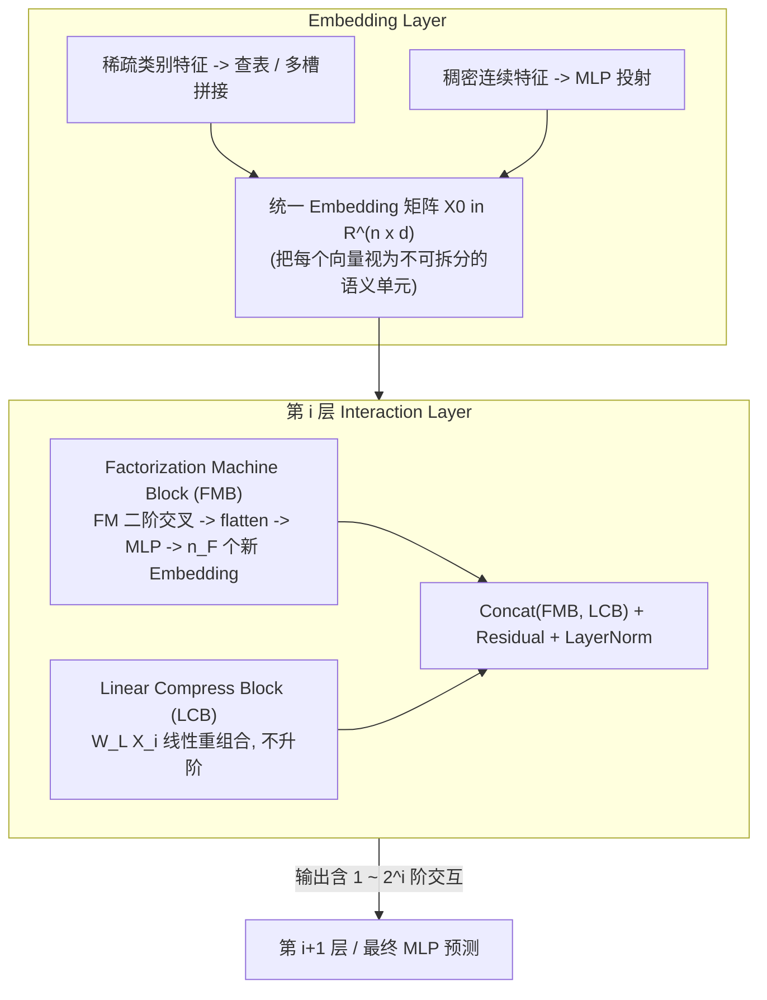

#### (1) 交互层更新公式
记第 $`i`$ 层输入为 $`X_i`$。FMB 与 LCB **并行**处理同一输入，拼接后再做残差与归一化：

```math
X_{i+1} = \mathrm{LN}\big( \mathrm{concat}\big( \mathrm{FMB}_i(X_i),\; \mathrm{LCB}_i(X_i) \big) + X_i \big)
```

若首层输出 Embedding 个数与输入不同，残差支路用线性压缩对齐形状。归纳即可证明：只要第 $`i`$ 层输入已含 $`1`$ 到 $`2^{i-1}`$ 阶，FMB 将两个 $`2^{i-1}`$ 阶项相乘便得到 $`2^{i}`$ 阶，LCB 则原样保留低阶，从而第 $`i`$ 层覆盖 $`1`$ 到 $`2^{i}`$ 阶。

#### (2) 因子分解机块 FMB：显式交叉后再嵌入化
FMB 先用 FM 得到成对交互矩阵，再经 MLP 把交互结果**重新编码为 Embedding**，供后续层继续交叉——MLP 在这里不是隐式交互器，而是交互结果的表征变换：

```math
\mathrm{FMB}(X_i) = \mathrm{reshape}\big( \mathrm{MLP}\big( \mathrm{LN}\big( \mathrm{flatten}\big( \mathrm{FM}(X_i) \big) \big) \big) \big)
```

最朴素的 FM 即全体向量两两点积 $`\mathrm{FM}(X) = X X^{T}`$。当特征数 $`n`$ 达到工业级（内部数据 720 个字段）时，$`O(n^{2} d)`$ 无法承受。Wukong 利用 $`X X^{T}`$ 至多秩 $`d`$ 的低秩结构，引入投影 $`Y \in \mathbb{R}^{n \times k}`$（$`k \ll n`$）：

```math
\mathrm{FM}_{\mathrm{opt}}(X) = X (X^{T} Y)
```

先算 $`X^{T} Y`$ 再左乘 $`X`$，复杂度由 $`O(n^{2} d)`$ 降为 $`O(n k d)`$。$`Y`$ 还可由线性压缩后的输入经 MLP 生成，使投影对当前样本自适应。整层复杂度约为 $`O(n d h \log n + h^{2})`$，其中 $`h`$ 为 FMB 内最大全连接宽度。

#### (3) 线性压缩块 LCB：保阶通道
LCB 只做 Embedding 的线性重组合，**不提升交互阶数**：

```math
\mathrm{LCB}(X_i) = W_{L} X_i, \quad W_{L} \in \mathbb{R}^{n_{L} \times n_{i}}
```

它保证深层仍能看到一阶原始信号，与残差一起构成“保阶高速公路”。消融表明：单独去掉 LCB 或残差质量只轻微下降，两者同时去掉则崩塌；FMB 一旦清零，质量大幅回退——说明**显式堆叠交叉才是 Wukong 的效果来源**。

#### 缩放策略与实验结论
扩展时优先加层数 $`l`$（提高最高交互阶），再同步放大 $`n_{F}`$、$`n_{L}`$、$`k`$ 与 FMB 内 MLP，以拓宽可表征的交互子空间。

- **公开集**：在 Frappe、MicroVideo、MovieLens、KuaiVideo、TaobaoAds、Criteo TB 六个基准上 AUC 全面超过 DCNv2、DLRM、AutoInt+、xDeepFM、FinalMLP、MaskNet。
- **内部超大规模数据**（1460 亿样本、720 个字段，Embedding 表固定约 627B）：Wukong 在同等算力下相对最强基线仍有约 0.2% Relative LogLoss 优势；质量随复杂度跨越**两个数量级**持续上升，延伸到 **100+ GFLOP/example**（训练算力可达 GPT-3 / LLaMA-2 量级），而 DCNv2 / AutoInt+ 放大后出现 Loss 爆炸，DLRM / FinalMLP 则在数十 GFLOP 后饱和。经验拟合约为每四倍算力换约 0.1% LogLoss 改进。
- **与 Transformer 的关键差异**：Wukong 外形像堆叠点积，但投影是 **Bit-wise MLP**（每个特征一套变换），层形状是 **金字塔式压缩** 而非 Transformer 的均匀宽度。把这两点接到 AutoInt+ 上可省约 90% FLOPs 并反超放大后的 AutoInt+——这与后文 FAT 所强调的“异质字段不该共享一套投影”是同一判断。

#### 定位与后续影响
Wukong 是推荐排序从“调交叉算子”转向“**Dense Scaling 交互骨干**”的关键节点：它证明质量可以随层数与宽度持续变好，也为 2025 年后 RankMixer / TokenMixer 的硬件化 Scaling 提供了效果侧的前置证据。局限同样清楚——在线服务超大 Wukong 仍贵，论文建议走基础模型多任务摊销或蒸馏；低秩 FM 虽已降复杂度，但尚未像 RankMixer 那样把全部计算收成高 MFU 的大 GEMM。

---

### 3.10 RankMixer：面向现代 GPU 架构的十亿级硬件亲和排序模型

- **论文标题**：[*RankMixer: Scaling Up Ranking Models in Industrial Recommenders*](https://arxiv.org/abs/2507.15551)
- **发表出处**：arXiv 2025
- **机构作者**：字节跳动（ByteDance 推荐与广告算法团队）

#### 工业革命性转折：硬件感知设计（Hardware-Aware Design）
字节团队首次系统性揭开了工业界排序模型 Scaling 失败的遮羞布：
在过去几年中，业界在 CPU 时代设计了无数眼花缭乱的手工交叉算子。Wukong 已经从效果侧证明 Dense Scaling 可行，但当整个推荐架构迁移至以 GPU 为主的现代基础设施时，这些模型（含低秩 FM）的**模型浮点运算利用率（MFU）低得令人发指——仅有 4.5% 左右！**
这意味着 GPU 上 95% 以上的时间全在等待显存 I/O，Tensor Core 的算力被闲置。

RankMixer 的核心哲学是：**完全面向现代 GPU 硬件架构逆向设计推荐交互模型，用高 MFU 的极简大矩阵计算平替一切零散算子！**

#### RankMixer 架构设计与推导

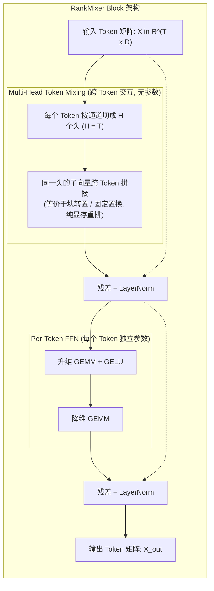

#### (1) 多头 Token 混合（Multi-Head Token-Mixing）
将 $`T`$ 个特征 Token 堆叠为 $`X \in \mathbb{R}^{T \times D}`$。每个 Token 按通道切成 $`H`$ 个头，再把所有 Token 的同一个头拼接起来，形成新的 Token：

```math
x_t = \big[\, x_t^{(1)},\, x_t^{(2)},\, \dots,\, x_t^{(H)} \,\big], \qquad s^{h} = \mathrm{concat}\big( x_1^{(h)}, x_2^{(h)}, \dots, x_T^{(h)} \big) \in \mathbb{R}^{TD/H}
```

```math
S = [\, s^{1}; \dots; s^{H} \,], \quad H = T, \qquad X' = \mathrm{LN}(S + X)
```

取 $`H = T`$ 保证输出与输入同形。该操作**不含任何参数**，本质是一次固定置换（等价于把 $`X`$ 切成 $`T \times T`$ 个块后做块转置，见 3.14、3.15），开销只是显存重排。它让每个新 Token 都包含全部原始 Token 的一个子空间切片，以近乎零 FLOPs 完成跨字段信息交换；非线性与参数全部集中在后面的 Per-Token FFN 中。这一“固定洗牌”也正是 2026 年 RankElastor、UniMixer、HeMix 等工作着力改进的对象。

#### (2) Per-Token 前馈网络（Per-Token FFN）
每个 Token 拥有独立的 FFN 参数，以适配不同特征子空间的异构分布：

```math
\mathrm{FFN}_t(s_t) = W_2^{(t)} \cdot \mathrm{GELU}\big( W_1^{(t)} s_t + b_1^{(t)} \big) + b_2^{(t)}, \quad t = 1, \dots, T
```

所有 Token 的 FFN 可合并为一次批量矩阵乘（Batched GEMM）执行，这是 RankMixer 高 MFU 的主要来源。

#### (3) 稀疏专家扩展（Sparse-MoE RankMixer）
为将模型容量推向 10 亿（1B）参数级别，RankMixer 将 Per-Token FFN 扩展为 Sparse-MoE 架构，采用动态 Top-2 路由，并引入负载均衡 Auxiliary Loss 防止专家坍缩。

#### 工业实测里程碑
在字节跳动万亿级生产样本集群上：
- **MFU 从 4.5% 暴增 10 倍至 45%**；
- 在**完全不增加线上推理延迟**的前提下，稠密参数量扩张 70～100 倍（上线 1B 稠密参数模型）；
- 全量上线抖音推荐与商业化广告核心业务，用户活跃天数（AAD）提升 +0.3%，应用使用总时长提升 **+1.08%**。

---

### 3.11 FAT：结构表达力与超网络解耦字段参数的 Field-Aware Transformer

- **论文标题**：[*From Scaling to Structured Expressivity: Rethinking Transformers for CTR Prediction*](https://arxiv.org/abs/2511.12081)
- **发表出处**：arXiv 2025
- **机构作者**：推荐大模型研究团队

#### 理论突破：揭示推荐大模型的“结构失配”
该论文从学习理论出发，证明了 Transformer 在推荐 CTR 预估中无法简单 Scaling 的核心症结为**结构失配（Structural Misalignment）**：
- **NLP 数据假设**：序列组合性（Sequential Compositionality），Token 在词表中遵循相同语法规则在时序上滑动；
- **CTR 表格数据本质**：异质字段的离散组合推理（Combinatorial Reasoning over Heterogeneous Fields）。
标准 Transformer 强行用一套共享权重对异质字段做自注意力，造成理论泛化界极差。

#### FAT 核心方法与数学推导

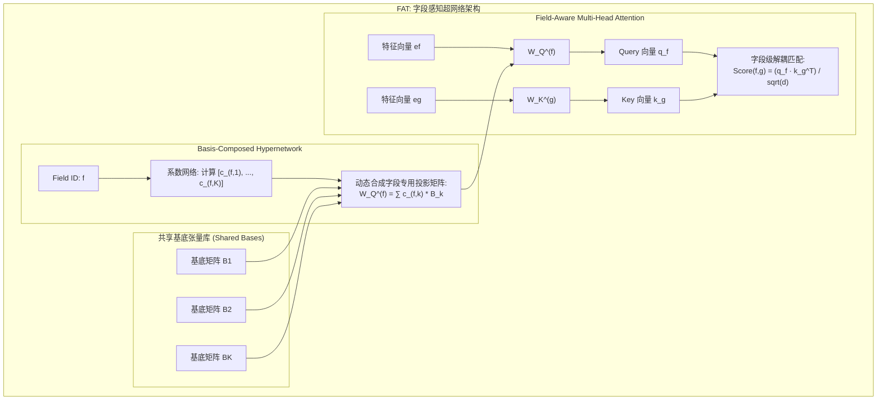

#### (1) 字段感知参数重构（Field-Centric Parameterization）
为彻底解决同质映射失配，FAT 赋予每一个 Field $`f \in \lbrace 1, \dots, M \rbrace`$ 专属性的参数矩阵 $`W_Q^{(f)}, W_K^{(f)}, W_V^{(f)}`$：

```math
q_f = W_Q^{(f)} e_f, \quad k_g = W_K^{(g)} e_g, \quad v_g = W_V^{(g)} e_g
```

```math
\mathrm{Attn}(f, g) = \frac{\exp\left( \frac{q_f k_g^T}{\sqrt{d}} \right)}{\sum_{u=1}^M \exp\left( \frac{q_f k_u^T}{\sqrt{d}} \right)}
```

#### (2) 基底超网络（Basis-Composed Hypernetwork）解耦参数爆炸
为防止独立参数矩阵造成参数量爆炸，FAT 在底层维护 $`K`$ 个全局共享的基底张量 $`\mathcal{B} = \lbrace B_1, B_2, \dots, B_K \rbrace`$（ $`K \ll M`$ ），任意字段 $`f`$ 的专属权重矩阵由超网络生成的系数线性组合而成：

```math
W_Q^{(f)} = \sum_{k=1}^K c_{f,k} B_k, \quad c_f = \mathrm{HyperNet}(f) \in \mathbb{R}^K
```

基底 $`B_k`$ 负责捕获全局元知识，系数 $`c_{f,k}`$ 调节字段个性化，彻底将模型容量扩展与输入字段数量 $`M`$ 实现解耦。

#### (3) Rademacher 复杂度泛化界保证
作者从统计学习理论推导了 FAT 的 Rademacher 复杂度上界，证明其泛化误差边界收敛速率显著优于标准 Transformer。在生产环境实测中，FAT 取得 AUC **+4.38%**，并在实际在线 A/B 测试中实现 CTR **+2.33%**，RPM **+0.66%**。

---

### 3.12 TokenMixer / TokenMixer-Large：百亿稠密参数推荐大模型的极限扩展

- **论文标题**：[*TokenMixer-Large: Scaling Up Large Ranking Models in Industrial Recommenders*](https://arxiv.org/abs/2602.06563)
- **发表出处**：arXiv 2026
- **机构作者**：字节跳动（ByteDance 推荐技术架构组）

#### 背景与深层架构瓶颈诊断
在将基于 TokenMixer 的网络向更深（8～16层）、更大（4B～15B）规模继续 Scaling 时，字节团队遭遇了三大瓶颈：
1. **模型架构“不纯（Impure）”与碎片遗留**：生产模型中依旧挂载着历史遗留的 DCN 等补丁算子；
2. **深层网络梯度耗散（Vanishing Gradients）**：超过 2～4 层后，深层特征更新严重停滞；
3. **MoE 稀疏化不彻底**：单卡内存与 All-to-All 通信上造成严峻显存突刺。

#### TokenMixer-Large 核心系统性进化

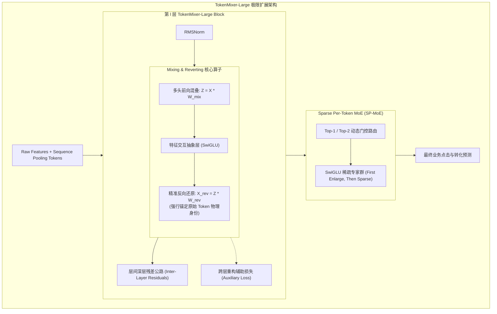

#### (1) 混叠与还原算子（Mixing & Reverting Operation）
以往的 Token 混合在连续多层后，中间表征彻底失去了原始语义物理标识。TokenMixer-Large 提出了对称的**混合-还原双射操作**：

```math
Z_l = \mathrm{Mix}(X_l; W_{\mathrm{mix}}^{(l)}) = X_l W_{\mathrm{mix}}^{(l)}
```

```math
\tilde{X}_l = \mathrm{NonLinear}(Z_l)
```

```math
X_{l+1} = \mathrm{Revert}(\tilde{X}_l; W_{\mathrm{rev}}^{(l)}) + X_l = \tilde{X}_l W_{\mathrm{rev}}^{(l)} + X_l
```

通过强行引入还原变换矩阵 $`W_{\mathrm{rev}}`$，保证每层输出始终投影回原始各个 Field 的物理对齐基底上，消除了深层表征漂移。

#### (2) 层间跳跃残差与辅助损失（Inter-Layer Residuals & Auxiliary Loss）
- 引入长程跳跃连接跨越多个 Block 直接流通信息；
- 提出浅层重构辅助目标（Auxiliary Self-Supervised Loss）：强制要求高层中间特征能够以较低误差重构浅层 Embedding，在损失函数端直接拉动底层梯度的有效回传。

#### (3) Sparse Per-Token MoE (SP-MoE)
采取**“先扩充后稀疏（First Enlarge, Then Sparse）”**策略：将 SwiGLU 中的全连接升维网络全部解耦为细粒度专家库，结合 Per-Token 动态路由，使得激活参数量仅占总参数量的约 25%。

#### 极限业务战果
TokenMixer-Large 成功实现了**在线流量 70 亿参数（7B）、离线实验 150 亿参数（15B）**的工业界纪录：
- **电商业务**：订单量提升 **+1.66%**，人均预览支付 GMV 提升 **+2.98%**；
- **商业化广告**：广告有效展示收益指标（ADSS）提升 **+2.0%**；
- **直播业务**：流水大盘提升 **+1.4%**。

---

### 3.13 RankUp：从输入侧抬高有效秩的五件套

- **论文标题**：[*RankUp: Towards High-rank Representations for Large Scale Advertising Recommender Systems*](https://arxiv.org/abs/2604.17878)
- **发表出处**：arXiv 2026
- **机构作者**：腾讯微信广告（Jin Chen, Shangyu Zhang, Bin Hu, Chao Zhou, Junwei Pan 等）

#### 背景与动机：参数变大，表征没有变“满”
RankUp 把 RankMixer 一类模型抽象为 MetaFormer：每层先做跨 Token 混合，再对每个 Token 做 FFN。

```math
H'_l = \mathrm{TokenMixer}\big(\mathrm{LN}(H_{l-1})\big) + H_{l-1}, \qquad h_{l,i} = \mathrm{FFN}\big(\mathrm{LN}(h'_{l,i})\big) + h'_{l,i}
```

作者用奇异值熵定义的有效秩 $`\mathrm{erank}(H) = \exp(-\sum_i p_i \ln p_i)`$（$`p_i = \sigma_i / \sum_j \sigma_j`$）跟踪每一层的表征，得到三个观察：
1. 层间有效秩呈**阻尼振荡**：Token Mixing 抬秩、FFN 压秩，深层没有持续展开；
2. 按语义分组切 Token 时，部分长尾 Token（如第 12 / 29 / 31 号）有效秩不到 20，而且 Token 之间相关性、共线性偏高，存在冗余；
3. 归因到算子：现有 Token Mixing 跨 Token 只能**有界抬秩**，Per-Token FFN 沿通道方向**压秩**，二者叠加使表征难以在深层保持丰富、可区分。

因此 RankUp 不改骨干的混合算子，而是从**输入构造**入手抬高初始有效秩，并在骨干中使用 PreNorm 与 SwiGLU。

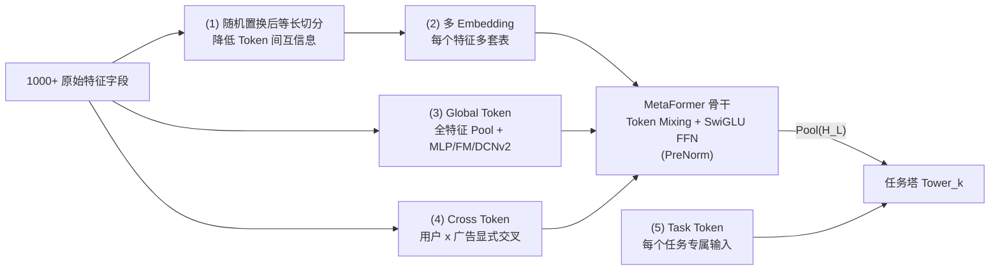

#### (1) 随机置换切分（Random Permutation Splitting）
不再按业务语义把相关特征分到同一个 Token，而是先对特征顺序做随机置换，再等长切分：

```math
F_{\sigma} = \lbrace f_{\sigma(1)}, f_{\sigma(2)}, \dots, f_{\sigma(M)} \rbrace
```

语义分组会让同组特征高度相关、组间信息分布不均；随机切分后每个 Token 都混入多种来源的特征，Token 间互信息下降，长尾 Token 的低秩问题也随之缓解。论文没有说明置换是否在训练中重采样，从线上一致性推断应在初始化时固定。

#### (2) 多 Embedding（Multi-Embedding）
沿用 Guo et al.（ICML 2024）缓解 Embedding 坍塌的思路，为每个特征准备多套 Embedding 表：

```math
e_j = \lbrace \psi_k(f_j) \;:\; \psi_k \in \mathcal{K}_j \rbrace
```

多套表从初始化开始就提供了多个独立方向，直接抬高输入矩阵的秩。

#### (3) 全局 Token（Global Token）
对全部特征 Embedding 做池化，再经一个轻量交互模块得到全局 Token，拼在序列最前面：

```math
g = \mathrm{func}\Big( \mathrm{Pool}\big(\lbrace \mathrm{Embed}(f_i) \rbrace_{i=1}^{M}\big) \Big), \qquad H^{(0)} = [\, g, e_1, \dots, e_T \,]
```

其中 $`\mathrm{func}`$ 可取 MLP、FM 或 DCNv2。全局 Token 让每一层都能看到全特征视角；去掉它后深层有效秩会从约 40 掉到约 38。

#### (4) 交叉 Token（Cross Token）
把用户侧与广告侧的表示做逐元素乘再投影，作为额外 Token 注入：

```math
e_{\mathrm{cross}} = \mathrm{Proj}\big( z_{\mathrm{ue}} \odot z_{\mathrm{ie}} \big)
```

这是把经典的“用户 × 物品”显式交叉先验以 Token 形式交给骨干。去掉交叉 Token 后，第 0 层的有效秩会显著下降。

#### (5) 任务 Token（Task Token）
多任务场景下，每个任务额外拥有专属输入，与骨干输出的池化结果一起送入任务塔：

```math
y^{(k)} = \mathrm{Tower}^{(k)}\Big( x_{\mathrm{task}}^{(k)},\; \mathrm{Pool}(H'_L) \Big)
```

#### 实验与线上结果
离线实验在微信视频号广告数据上进行（日均约 2000 万样本、1200+ 特征），基线为 2 层 RankMixer：

| 设置 | 下单 (Order) AUC | 预约 (Book) AUC | 加服务 (Add Service) AUC |
| :--- | :--- | :--- | :--- |
| 仅 Global Token + 多 Embedding | +0.21% | +0.18% | +0.13% |
| RankUp 完整版 | **+0.41%** | **+0.23%** | **+0.25%** |

线上部署为 2 层骨干，单场景稠密参数从约 1000 万扩到约 1 亿，batch 300 时每批约 70 GFLOPs，**MFU 23%**，同时服务 32 个任务、1000+ 字段。20% 流量、14 天 A/B 结果：

| 场景 | AUC | CTCVR | GMV | 新广告 GMV |
| :--- | :--- | :--- | :--- | :--- |
| 视频号 | +0.367% | +1.41% | **+3.41%** | +5.83% |
| 公众号 | +0.331% | +0.21% | **+4.81%** | +9.67% |
| 朋友圈 | +0.269% | +0.87% | **+2.12%** | +2.84% |

下单任务的 GMV 在三个场景分别提升 +5.18% / +7.18% / +4.79%。

#### 定位与局限
RankUp 的价值在于把“表征坍塌”从诊断变成可直接上线的工程手段，几乎不改骨干、成本可控。局限是这些手段都作用在输入侧与读出侧，Token Mixing 与 FFN 本身的“抬秩—压秩”机制没有改变，这正是 RankElastor 要解决的问题。

---

### 3.14 RankElastor：从结构上修复 RankMixer 的锯齿状坍塌

- **论文标题**：[*Expand More, Shrink Less: Shaping Effective-Rank Dynamics for Dense Scaling in Recommendation*](https://arxiv.org/abs/2605.23191)
- **发表出处**：KDD 2026
- **机构作者**：香港科技大学（广州）、腾讯（Guoming Li, Shangyu Zhang, Junwei Pan 等；通讯作者 Menglin Yang）；代码：[vasile-paskardlgm/RankElastor](https://github.com/vasile-paskardlgm/RankElastor)

#### 背景与动机：解释“为什么抬秩有限、压秩不止”
RankElastor 采用稳定秩口径 $`\mathrm{erank}(X) = \lVert X \rVert_F^{2} / \lVert X \rVert_2^{2}`$，在 Criteo 等数据上观察到：DCNv2、xDeepFM 的有效秩随深度单调衰减；RankMixer 呈锯齿状，混合层抬秩、FFN 层压秩。论文从理论上解释了这两个过程。

**混合层只能有界抬秩**。RankMixer 的混合可写成块转置：把 $`X \in \mathbb{R}^{T \times D}`$（$`D = T \cdot d`$）切成 $`T \times T`$ 个 $`1 \times d`$ 的块，令 $`(\mathcal{T}(X))_{ij} = X_{ji}`$，再与残差相加得到 $`M = X + Y`$，其中 $`Y = \mathcal{T}(X)`$。定理 2.1 在 $`X`$ 与 $`Y`$ 近似 Frobenius 正交、谱不相干的假设下给出（$`k`$、$`\mu`$ 分别为 $`X`$、$`Y`$ 的有效秩）：

```math
\frac{2k\mu}{(\sqrt{k} + \sqrt{\mu})^{2}} \le \mathrm{erank}(X + Y) \le 2(k + \mu)
```

即“残差 + 置换”确实能抬秩，但幅度有上限；而推荐 Embedding 在初始化阶段往往已经谱坍塌，因此实际抬升很有限。

**FFN 倾向于压秩**。定理 2.2 指出，对随机初始化、使用正齐次激活（如 ReLU）的逐行 FFN $`\varphi(XA)B`$：秩 1 输入的输出有效秩不超过 2；在一定的预激活条件下，以至少 $`1 - e^{-ck}`$ 的概率满足 $`\mathrm{erank}(\text{out}) \le \alpha \cdot \mathrm{erank}(\text{in})`$，$`\alpha \in (0, 1)`$。

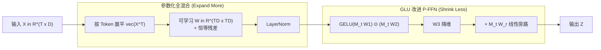

#### (1) 从块置换到参数化全混合
RankMixer 的混合（含残差）可以等价写成作用在展平向量上的 Kronecker 结构置换：

```math
\mathrm{vec}(M^{\top}) = \mathrm{LN}\Big( (P \otimes I)\, \mathrm{vec}(X^{\top}) + \mathrm{vec}(X^{\top}) \Big)
```

RankElastor 将其放开为任意可学习的稠密矩阵：

```math
\mathrm{vec}(M^{\top}) = \mathrm{LN}\Big( (W + I)\, \mathrm{vec}(X^{\top}) \Big), \qquad W \in \mathbb{R}^{TD \times TD}
```

定理 3.1 证明，块大小 $`d^{*} > 1`$ 的块混合函数族严格包含于 $`d^{*} = 1`$（坐标级）的函数族，也就是说坐标级全混合的表达能力严格更强。

#### (2) GLU 改进 P-FFN
在每个 Token 的 FFN 中加入门控乘法与线性旁路：

```math
Z_t = \Big( \mathrm{GELU}(M_t W_1) \odot (M_t W_2) \Big) W_3 + M_t W_r
```

定理 3.2 证明，门控乘法引入的二次项使输出秩下界达到 $`\min(D, k(k+1)/2)`$，并且有效秩能比输入提升 $`\delta`$，从“压秩”变成“可抬秩”。

#### (3) 复杂度
- 混合层：从 RankMixer 的 $`O(TD)`$、零参数，变为 $`O(T^{2} D^{2})`$；
- FFN：$`O(T(3r + 1) D^{2})`$（$`r`$ 为扩展倍数）；
- 实测训练耗时较 RankMixer 增加约 10%～15%（公开数据集规模，如 $`T = 15`$、$`D = 26`$、$`r = 3`$）。

#### 实验结果
| 数据集 | RankMixer AUC | RankElastor AUC |
| :--- | :--- | :--- |
| Criteo | 0.81375 | **0.81482** |
| Avazu | 0.79270 | **0.79323** |

在 KuaiVideo、TaobaoAd 上同样最优。消融显示两部分有协同：只给 RankMixer 换 GLU-FFN 得到 0.81393，去掉全混合的 RankElastor 得到 0.81413，二者都明显低于完整版 0.81482。

#### 定位与局限
RankElastor 从理论上说明了 RankMixer 锯齿状有效秩的来源，并给出对应的结构修复，是“表征秩”支线中解释性最强的一篇。局限也很明显：
- **只有公开数据集结果，没有工业上线**；
- 全混合矩阵 $`W \in \mathbb{R}^{TD \times TD}`$ 的参数量随规模平方增长。按工业常见的 $`T = 32`$、$`D = 768`$ 估算，$`TD \approx 2.5 \times 10^{4}`$，单层混合约 6 亿参数，几乎不可能直接上线，需要结构化压缩。UniMixer 的“全局 × 局部”分解正是一种可行的压缩方案（见 3.15）。

---

### 3.15 UniMixer：把 TokenMixer 参数化，统一 Attention、TokenMixer 与 FM

- **论文标题**：[*UniMixer: A Unified Architecture for Scaling Laws in Recommendation Systems*](https://arxiv.org/abs/2604.00590)
- **发表出处**：arXiv 2026
- **机构作者**：快手（Mingming Ha, Guanchen Wang 等）

#### 背景与动机：三种 Scaling 范式缺少共同语言
当前推荐 Scaling 有三条路线：基于 Attention（HiFormer、FAT 等）、基于 TokenMixer（RankMixer、TokenMixer-Large）、基于 FM（Wukong 等）。UniMixer 指出，TokenMixer 的混合规则完全来自经验设计，与另外两条路线之间缺少理论联系；它还要求头数等于 Token 数（$`H = T`$），限制了结构灵活性。

#### (1) TokenMixer 等价于一个大置换矩阵
RankMixer 的混合 $`s^{h} = \mathrm{concat}(x_1^{(h)}, \dots, x_T^{(h)})`$ 可写成对展平向量的一次线性变换：

```math
\mathrm{TokenMixer}(X) = \mathrm{reshape}\big( W^{\mathrm{perm}}\, \mathrm{flatten}(X) \big)
```

该置换矩阵具有四个性质：可压缩（可写成 $`G \otimes I`$）、双随机（行和、列和均为 1）、稀疏、对称。UniMixer 的思路就是保留这些结构性质，同时把它变成可学习的。

#### (2) UniMixing：全局块混合 × 块内局部混合
把长度为 $`L`$ 的展平向量切成 $`L/B`$ 个大小为 $`B`$ 的块。先在每个块内做局部线性变换 $`x_i W_B^{i}`$ 得到 $`H`$，再用全局矩阵在块之间混合：

```math
\mathrm{UniMixing}(X) = \mathrm{reshape}\Big( W_G \cdot \mathrm{reshape}\big(H,\; L/B,\; B\big),\; 1,\; L \Big)
```

复杂度为 $`O(L^{2}/B + LB)`$，远低于全混合的 $`O(L^{2})`$。为了保持置换矩阵的性质，权重先对称化，再用 Sinkhorn-Knopp 迭代投影为双随机矩阵，温度 $`\tau`$ 从 1.0 退火到 0.05，使其逐渐接近稀疏的置换：

```math
\tilde{W} = \frac{W + W^{\top}}{2}, \qquad W^{*} = \mathrm{SinkhornKnopp}\big(\tilde{W} / \tau\big), \qquad O = \mathrm{RMSNorm}\big(X + \mathrm{UniMixing}(X)\big)
```

#### (3) 统一框架：三种范式只是“全局 × 局部”的不同取法
在单头设定下，三类方法都可写成“全局混合模式 × 局部变换”：

| 方法 | 局部变换 | 全局混合模式 |
| :--- | :--- | :--- |
| Self-Attention | $`XW_V`$ | $`\mathrm{softmax}(QK^{\top}/\sqrt{d})`$ |
| 异构 Attention | Token 专属的 $`W_V`$ | Token 专属投影后的 $`\mathrm{softmax}(QK^{\top}/\sqrt{d})`$ |
| TokenMixer | $`X`$（恒等） | 与输入无关的常数置换 $`G`$ |
| FM（Wukong） | 与输入无关的可学习矩阵 $`Y`$ | $`XX^{\top}`$ |

当 Attention 的 $`W_Q = W_K = I`$、Value 与输入无关时就退化为 FM；当全局模式与输入无关时就是 TokenMixer。UniMixer 的 $`W_G`$ 与注意力权重维度、角色相同，只是额外要求双随机、稀疏、对称。

#### (4) UniMixer-Lite 与深层稳定
- **Lite 版**：局部矩阵由少量共享基底加权组合，全局矩阵做低秩分解，参数大幅减少：

```math
W_B^{*i} = \mathrm{SK}\Big( \sum_{\ell} \omega_{\ell}^{i} Z_{\ell} \Big), \qquad W_r = \mathrm{SK}(A_G B_G)
```

- **FFN**：每个 Token 独立的 pSwiGLU；
- **SiameseNorm**：维护一条归一化流 $`\bar{X}`$ 与一条不归一化的残差流 $`\bar{Y}`$，兼顾 PreNorm 的梯度通畅与 PostNorm 的表征稳定：

```math
O_{\ell} = \mathrm{UniMixer}\big(\bar{X}_{\ell} + \mathrm{RMSNorm}(\bar{Y}_{\ell})\big), \qquad \bar{X}_{\ell+1} = \mathrm{RMSNorm}(\bar{X}_{\ell} + O_{\ell}), \qquad \bar{Y}_{\ell+1} = \bar{Y}_{\ell} + O_{\ell}
```

最终输出 $`\bar{X}_{M} + \mathrm{RMSNorm}(\bar{Y}_{M})`$，之后再接 Sparse Per-token MoE。

#### 实验结果
任务为快手广告投放的用户留存预估（约 7 亿样本），指标为相对异构 Attention 基线的 ΔAUC：

| 模型 | 参数量 | ΔAUC |
| :--- | :--- | :--- |
| HiFormer | — | −0.289% |
| Wukong | — | −0.010% |
| FAT | — | +0.031% |
| TokenMixer-Large | — | +0.383% |
| RankMixer | 135.5M（1.68T FLOPs） | +0.475% |
| UniMixer（2 Blocks） | 67.5M（2.07T FLOPs） | +0.519% |
| UniMixer-Lite（4 Blocks） | 38.2M | +0.775% |
| UniMixer-Lite（4 Blocks） | 84.5M | **+0.814%** |

- **Scaling 曲线更陡**：拟合的 Scaling 指数 RankMixer 为 0.116、UniMixer 为 0.132、Lite 为 0.142；
- **可以加深**：RankMixer 从 2 层加到 4 层 AUC 下降 0.107%；Lite 从 2 层加到 4 层 +0.158%，8 层 +0.165%；
- **消融**：去掉温度退火 −0.165%、去掉 warm-up −0.086%、去掉对称约束 −0.057%、SiameseNorm 换成 PostNorm −0.027%；
- **线上**：用户留存 CAD（D1～D30 平均）提升超过 15%。

#### 定位与局限
UniMixer 第一次把三条 Scaling 路线放进同一框架，并给出一种结构化、可学习的 Token Mixing，在参数效率上明显优于 RankMixer。需要注意：实验任务是用户留存而非 CTR/CVR，与其他论文的数字不能直接对比；Sinkhorn 迭代与温度退火也增加了训练调参成本。

---

### 3.16 HeMix：混合 Query 兴趣抽取与异构低秩 Token 混合

- **论文标题**：[*HeMix: Scaling Industrial Ranking Models with Heterogeneous Token Mixing*](https://arxiv.org/abs/2602.09387)（早期版本题为 *Query-Mixed Interest Extraction and Heterogeneous Interaction: A Scalable CTR Model for Industrial Recommender Systems*）
- **发表出处**：arXiv 2026
- **机构作者**：阿里巴巴高德（AMAP）（Fangye Wang, Guowei Yang, Xiaojiang Zhou 等）

#### 背景与动机
高德的排序输入包括用户特征 U、物品特征 I、上下文 C，以及两条互不重叠的行为序列：全局序列 G_S（长期历史，平均长度约 332）与实时序列 RT_S（仅当天行为，平均长度约 10）。HeMix 要解决两个问题：
1. 行为序列中既有与当前上下文相关的兴趣，也有与上下文无关的长期偏好，只用候选作 Query 会漏掉后者；
2. RankMixer 的无参重排没有非线性，也不区分不同头的异构性。

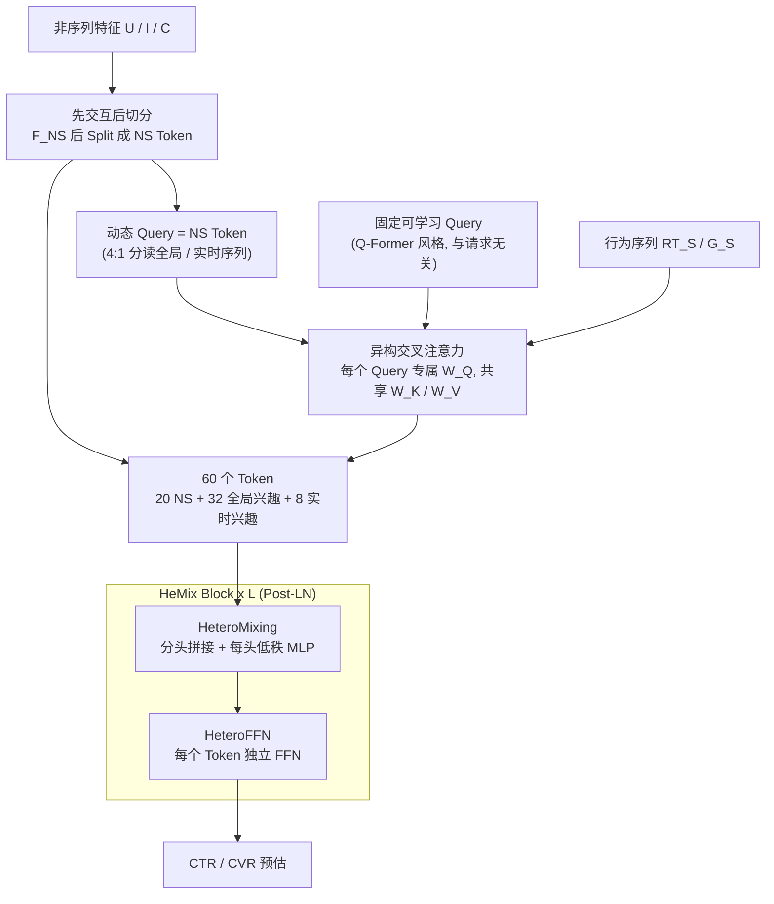

#### (1) 先交互后切分的非序列 Token
先对非序列特征做整体交互，再切成 Token，而不是先按字段切再交互：

```math
T_{NS} = \mathrm{Split}\big( F_{NS}(E_{U,I,C}),\; d_T \big)
```

#### (2) 混合 Query 兴趣抽取
NS Token 本身就是**动态 Query**（随当前请求与候选变化），按 4:1 分成两组：大组读取全局序列，小组读取实时序列。另外再初始化同形状的两组**固定可学习 Query**（与请求无关，借鉴 BLIP-2 的 Q-Former），用于抽取与当前候选不相关、但仍有预测力的固有行为模式；对序列较短或噪声大的用户，固定 Query 也提供更稳定的信号。每个 Query 有专属的 $`W_Q^{(l)}`$，$`W_K`$、$`W_V`$ 共享：

```math
O^{G} = \big[\, O^{(1)}; O^{(2)}; \dots; O^{(L_Q)} \,\big]\, W_O
```

复杂度为 $`O(L_Q L_G d)`$，与序列长度线性相关。每条序列都由等量的动态 Query 与固定 Query 读取，因此序列 Token 数恰为 NS Token 的 2 倍。最终得到 60 个 Token：20 个 NS Token、32 个全局序列兴趣 Token（16 动态 + 16 固定）、8 个实时序列兴趣 Token（4 动态 + 4 固定），维度 $`d_T = 256`$。

#### (3) HeteroMixing：在“拆分—重组”中间插入每头独立的低秩 MLP
沿用 RankMixer 把各 Token 的同一头拼起来的做法，但对每个头 $`m`$ 的拼接结果再做一次独立的低秩非线性变换：

```math
G_m = \mathrm{concat}\big( T_1^{(m)}, \dots, T_N^{(m)} \big), \qquad \hat{G}_m = W_m^{R}\, \mathrm{ReLU}\big( W_m^{L} G_m \big)
```

低秩维度为 $`d_r`$，复杂度 $`O(N d_T d_r)`$，混合后的秩上限为 $`M \cdot d_r`$。整个 Block 采用 Post-LN：

```math
S_l = \mathrm{LN}\big( \mathrm{HeteroMixing}(T_{l-1}) + T_{l-1} \big), \qquad T_l = \mathrm{LN}\big( \mathrm{HeteroFFN}(S_l) + S_l \big)
```

HeteroFFN 为每个 Token 独立的 FFN（扩展倍数 $`k = 4`$），参数量约 $`2kLNd_T^{2}`$。

#### 实验结果
离线数据约 44 亿样本，指标为 CTR-AUC：

| 模型（约 1 亿参数规模） | CTR-AUC | GFLOPs |
| :--- | :--- | :--- |
| DLRM | 0.7312 | — |
| RankMixer | 0.7341 | — |
| HyFormer | 0.7343 | — |
| OneTrans | 0.7344 | 2.32 |
| **HeMix** | **0.7350** | **1.89** |

- 约 15 亿参数规模：HeMix-L 0.7366（27.58 GFLOPs），OneTrans-L 0.7359（34.49 GFLOPs）；
- 只换交互模块：用 RankMixer Block 为 0.7345，用标准 Transformer 为 0.7336，均低于 HeteroMixing；
- Token 消融：去掉实时序列 −0.0022、去掉全局序列 −0.0014、去掉固定 Query −0.0005、去掉混合 Query −0.0008；
- Scaling 效率：RankMixer 需要约 8.5 亿参数、16 GFLOPs 才能达到 HeMix 的效果，HeMix 约有 8 倍效率优势；
- **线上（约 1 亿参数版本）**：相对 DLRM，GMV +3.61%、PV_CTR +2.78%、UV_CVR +2.12%；相对 RankMixer，GMV +0.88%、PV_CTR +2.74%、UV_CVR +0.84%。

#### 定位与局限
HeMix 同时改进了序列兴趣抽取与 Token 混合两处，是“参数化 Token Mixing”支线中最早落地的工业方案之一。它属于“部分统一”：序列先被 Query 压缩成兴趣 Token，再与非序列 Token 交互，没有像 TokenFormer、EST 那样保留全部原始行为 Token。

---

### 3.17 TokenFormer：统一多字段与序列建模，并阻断序列坍缩传播

- **论文标题**：[*TokenFormer: Unify the Multi-Field and Sequential Recommendation Worlds*](https://arxiv.org/abs/2604.13737)
- **发表出处**：arXiv 2026
- **机构作者**：腾讯（Yifeng Zhou, Yuehong Hu, Zhixiang Feng, Junwei Pan 等；Jie Jiang）

#### 背景与动机：朴素统一会把序列“拖坍”
推荐系统长期有两条独立路线：特征交叉模型建模多字段之间的关系，序列模型建模用户行为的时序。TokenFormer 把实体分为三类：静态字段 F、行为序列 T、目标候选 V，它们之间共有六种交互（F-F、F-T、F-V、T-T、T-V、V-V）。

把三者直接拼进一个 Transformer，作者观察到**序列坍缩传播（Sequential Collapse Propagation）**：工业场景中很多非序列特征因基数低、频次偏斜而信息量不足，其 Embedding 容易挤在低维子空间（即 Guo et al. 2024 所说的 Embedding 坍塌）。在解耦架构中这种坍塌被隔离在各自分支里，而在共享骨干中，与这些“维度病态”的字段交互会把序列表征也拖向维度坍塌。此外，朴素 Transformer 的高层注意力会出现“漂移”，持续回头关注远处的非序列位置，平均感受野在最后几层反而从 40.0 扩大到 46.4。

#### (1) 统一 Token 流与位置编码
所有实体按如下顺序排成一条序列，用分隔 Token 隔开：

```math
\big[\, x^{F}_{1}, \dots, x^{F}_{M},\; e_{\mathrm{sep}},\; x^{T}_{s_1}, x^{T}_{a_1}, \dots,\; e_{\mathrm{sep}},\; x^{V}_{c_1}, \dots, x^{V}_{c_K} \,\big]
```

不使用类型 Embedding，只用 RoPE 区分：静态字段位置为 0，行为 Token 按时间位置编号，候选位置统一为 $`S_L + 1`$。

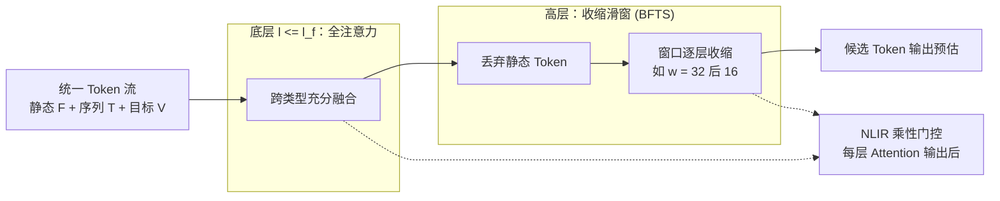

#### (2) 统一交互块（UIB）
每层由带掩码的注意力与门控交互组成：

```math
\tilde{A} = \mathrm{Attn}(X, M_{\mathrm{BFTS}}), \qquad X^{l+1} = \mathrm{FFN}\big( \mathrm{NLIR}(\tilde{A}, X) \big)
```

#### (3) BFTS：先全后窄的分层注意力
注意力窗口随层数变化：底层（$`l \le l_f`$）$`\omega(l) = \infty`$，即全注意力，让静态字段与序列充分融合；高层改为滑动窗口 $`\omega(l) = w_l`$ 且逐层收缩，同时丢弃静态 Token，只在序列与候选之间做局部交互。这样静态 Token 不会在深层持续把序列拖向低秩，计算量也随之下降。

#### (4) NLIR：非线性交互表征
对注意力输出做 Sigmoid 乘性门控，再接 RMSNorm 与 SwiGLU：

```math
G = XW_g, \qquad \tilde{I} = \sigma(G) \odot \tilde{A}, \qquad I = X + \tilde{I}
```

乘性门控为每个维度提供输入相关的选择，与 RankElastor 中 GLU 抬秩的作用类似。

#### 实验结果
- **公开数据集 KuaiRand-27K**：TokenFormer-T 相对基线 +5.00‰（仅 0.48M 参数），HSTU-Ultra 为 +2.95‰；TokenFormer-L 达到 +8.15‰。在新曝光场景，TokenFormer-S* +11.42‰，HyFormer +10.44‰，OneTrans +6.44‰；
- **BFTS 层配置**：2 层全注意力 + 2 层滑窗（2F2S）比 4 层全注意力（4F）高 0.85‰，且 GFLOPs 少 20%；反过来先滑窗后全注意力（2S2F）−6.18‰，全部滑窗（4S）−36.35‰；窗口 [32, 16] 比 [32, 32] 高 1.53‰；
- **消融**：NLIR 贡献 +4.87‰，BFTS 贡献 +4.91‰；
- **线上消融（相对 DLRM）**：全注意力 −0.16%，换成 BFTS +0.14%，再加 NLIR +0.22%；
- **线上 A/B**：微信视频号广告，5% 流量，2026 年 1～2 月，**GMV +4.03%**。

#### 定位与局限
TokenFormer 把表征坍塌的视角从特征交叉延伸到“特征交叉 + 序列”的统一建模，并给出简单有效的分层注意力策略。从 2S2F 大幅掉点可以看出，“先充分融合、再局部聚焦”的顺序是关键。当前实验的序列长度与 Token 规模仍偏中等，超长序列下的成本有待验证。

---

### 3.18 EST：不做有损早聚合的高效可扩展 CTR Transformer

- **论文标题**：[*EST: Towards Efficient Scaling Laws in Click-Through Rate Prediction via Unified Modeling*](https://arxiv.org/abs/2602.10811)
- **发表出处**：KDD 2026
- **机构作者**：阿里巴巴淘宝展示广告（Mingyang Liu, Yong Bai, Zhangming Chan 等；Xiang-Rong Sheng, Han Zhu, Jian Xu）

#### 背景与动机：哪部分交互真正有价值？
传统流水线用 DIN、SIM 等模块先把行为序列聚合成少量向量，丢失了 Token 级信息。直接把所有 Token 放进 Transformer 又会带来二次复杂度。EST 先做了两组诊断实验：

1. **按块掩码注意力**：把注意力矩阵按“非行为 N / 行为 B”分成四块，逐块掩掉后：掩掉 ⟨N, B⟩（非行为 Token 读取行为 Token）AUC 下降 0.20%，掩掉其余三块只下降 0.01%～0.03%。**信息密度高度不对称**；
2. **内容信息的接入方式**：把多模态内容表征做成 SimTier（相似度分桶）带来 +1.18%，作为 side info 拼接只有 +0.44%，作为语义 ID 只有 +0.47%。**内容相似度比内容向量本身更有用**。

据此 EST 只保留高价值的交互方向，并用内容相似度做行为之间的稀疏聚合。

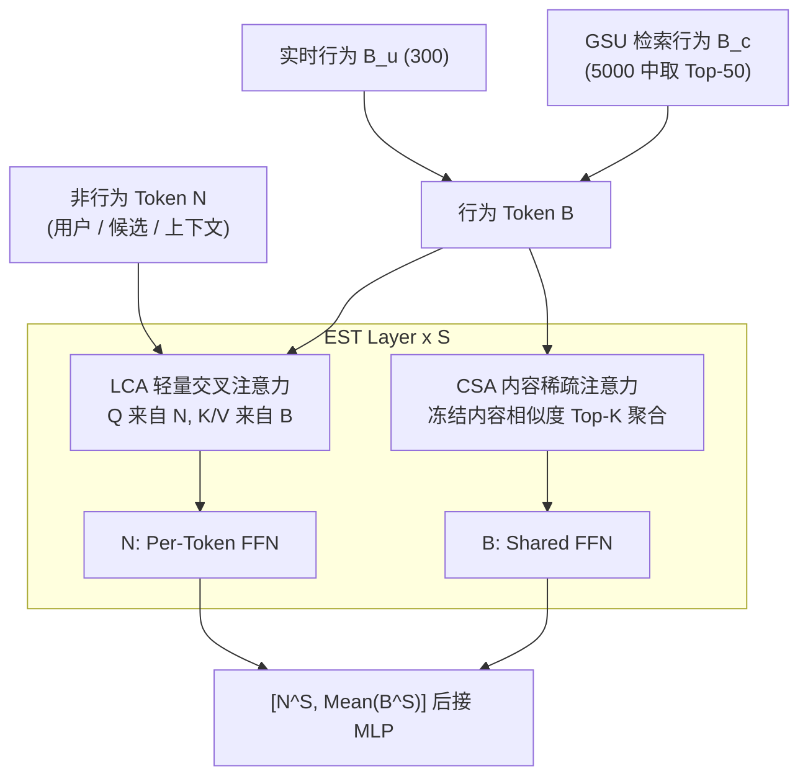

#### (1) 层结构

```math
N \leftarrow \mathrm{LCA}\big(\mathrm{Norm}(N), \mathrm{Norm}(B)\big) + N, \qquad B \leftarrow \mathrm{CSA}\big(\mathrm{Norm}(B)\big) + B
```

之后非行为 Token 使用 Per-Token FFN（每个 Token 独立参数），行为 Token 使用共享 FFN。最终输出 $`[\, N^{S}, \mathrm{Mean}(B^{S}) \,]`$ 送入 MLP。

#### (2) LCA：轻量交叉注意力
只让非行为 Token 作为 Query 去读取行为 Token：$`Q_N = \varphi(N, W^{Q})`$，其中 $`W^{Q}`$、$`W^{O}`$ 为 Token 专属（沿用 HiFormer 的异构投影思路），$`W^{K}`$、$`W^{V}`$ 共享。复杂度从全量自注意力的 $`O((L_N + L_B)^{2} d)`$ 降到 $`O(L_N L_B d)`$；用户行为 $`B_u`$ 的 K/V 与候选无关，可在同一请求的多个候选间复用。

#### (3) CSA：内容稀疏注意力
行为之间的交互不再学习注意力分数，而是直接用冻结的多模态内容向量 $`M`$ 计算相似度，取 Top-K 加权求和：

```math
G = M M^{\top}, \qquad \Omega_i = \mathrm{TopK}(G_{i,:}, K), \qquad b_i' = \sum_{j \in \Omega_i} G_{ij}\, b_j, \quad K = 5
```

权重直接取内容相似度本身，不含可学习参数（training-free）；复杂度为 $`O(LKd)`$，同时引入了诊断实验中最有效的内容相似度信号。

#### (4) 训练策略
稀疏参数用生产模型初始化；每个 epoch 重置稀疏参数、保留稠密参数，缓解多 epoch 训练中稀疏 Embedding 的过拟合，带来 +0.44% GAUC。

#### 实验结果
- **离线**：EST AUC 0.6963（+0.99%），GAUC +0.87%；计算量 18.48 GFLOPs，比 OneTrans-F 的 52.79 GFLOPs 少 65%；
- **消融**：LCA 使 GFLOPs 减少 72.23%，GAUC 只损失 0.03%；再加 CSA 回升 +0.14%；
- **Scaling Law**：按深度扩展，效果与算力 C、参数量 P 的关系分别为 $`0.61 \cdot C^{0.12}`$、$`0.46 \cdot P^{0.14}`$；按宽度扩展分别为 $`0.68 \cdot C^{0.10}`$、$`0.63 \cdot P^{0.08}`$，加深比加宽更有效；
- **线上**：“猜你喜欢” CTR +1.22%、RPM +3.27%；“购后” CTR +2.01%、RPM +2.66%。

#### 定位与局限
EST 用简单的掩码实验找到了统一建模中真正有价值的交互方向，并据此把复杂度降到近线性，思路清晰、工程上容易复用。它的取舍也意味着行为 Token 不会读取非行为 Token、非行为 Token 之间也没有显式交互；在序列信息不占主导的场景，这一取舍是否成立需要重新验证。

---

### 3.19 SORT：系统性改造标准 Transformer 作为工业精排骨干

- **论文标题**：[*SORT: A Systematically Optimized Ranking Transformer for Industrial-scale Recommenders*](https://arxiv.org/abs/2603.03988)
- **发表出处**：CIKM 2026（本文数字取自 arXiv v3）
- **机构作者**：阿里巴巴 AliExpress（Chunqi Wang 等；Xiaoyi Zeng）

#### 背景与动机：推荐数据“稀疏 × 稀疏”
SORT 认为，标准 Transformer 在推荐精排中难以直接复用 LLM 经验，根本原因是推荐数据同时具有**高特征稀疏**（ID 类特征多、长尾严重）和**低标签密度**（只有稀疏的点击、转化等二值标签）。前者使 Embedding 难以学好，后者使大模型难以被充分监督。SORT 没有发明新算子，而是从样本、结构、训练、系统四个层面系统性地改造标准 Transformer。

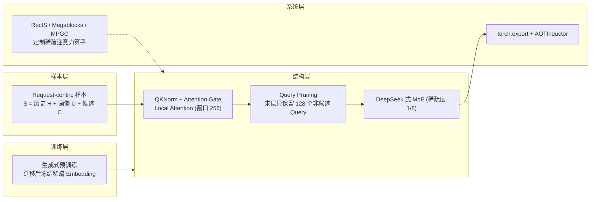

#### (1) Request-centric 样本组织
把同一请求下的多个候选组织成一个样本 $`S = \langle H, U, C \rangle`$，输入序列为：

```math
[\, \mathrm{BOS};\; \mathrm{Tok}(H);\; \mathrm{SEP};\; \mathrm{Tok}(U);\; \mathrm{SEP};\; \mathrm{Tok}(C) \,]
```

候选之间使用对角掩码（互不可见）并共享同一位置编号，从而一次前向就能给一个请求内的所有候选打分，历史与画像的计算在候选间摊销。模型不使用 user id，以减少对高稀疏 ID 的依赖。

#### (2) 注意力与结构改造
- **QKNorm + Attention Gate**：稳定大模型训练；
- **Local Attention**：历史 Token 只关注局部窗口，窗口 256 效果最好，优于全量因果注意力；
- **Query Pruning**：逐层减少非候选 Query，最后一层最多保留 128 个，计算量从 43G 降到 24G FLOPs，效果反而 +0.26pt；
- **DeepSeek 式 MoE**：细粒度专家 + 共享专家，激活稀疏度 1/8；
- **特殊 Token**（BOS / SEP）：+0.33pt。

#### (3) 生成式预训练（GPSD）与冻结稀疏参数
针对低标签密度，先在行为序列上做生成式预训练，再迁移到精排：

| 训练方式 | AUC |
| :--- | :--- |
| 从零训练 | 0.7175 |
| 迁移预训练参数 | 0.7162 |
| 迁移 + 冻结稀疏 Embedding | **0.7456**（+2.81pt；CVR +1.34pt，加购 +2.08pt） |

只迁移不冻结反而略降，说明收益主要来自预训练得到的稀疏 Embedding 在精排阶段不被稀疏标签破坏。

#### (4) 训练与推理系统
训练侧使用 RecIS、Megablocks、MPGC 与定制稀疏注意力算子，MFU 从 13% 提升到 **22%（base）/ 45%（large）**；推理侧用 torch.export + AOTInductor 编译，吞吐 +29.4%、延迟 −29.3%。

#### 实验结果
离线数据约 6 亿请求、90 亿曝光，稀疏 Embedding 参数约 200 亿：
- **SORT-base**：+0.41pt，稠密参数 85M（基线 18M），计算量 24G FLOPs（基线 43G）；同期 HSTU −0.18pt，OneTrans +0.20pt；
- **SORT-large**：+0.51pt，188G FLOPs（基线 322G）；
- **Scaling 结论**：对效果的贡献排序为 数据量 > 序列长度 > 模型尺寸。

线上 A/B（4 个场景，1 个月；DLRM 基线使用超过 1 年数据训练，SORT 只用 3 个月）：

| 场景 | 订单 | 买家数 | GMV | 延迟 | 吞吐 |
| :--- | :--- | :--- | :--- | :--- | :--- |
| 首页 | +2.37% | +2.58% | +10.01% | −62% | +325% |
| 详情页 | +8.99% | +7.46% | +11.49% | −51% | +405% |
| 购物车 | +7.10% | +6.74% | +6.98% | −64% | +448% |
| 支付后 | +11.43% | +9.91% | +6.12% | −72% | +1180% |
| **宏平均** | **+7.47%** | **+6.67%** | **+8.65%** | **−62%** | **+589%** |

注：arXiv v1 报告的是 MFU 22% 与订单 / 买家 / GMV +6.35% / +5.97% / +5.47%，不同版本数字有差异。

#### 定位与局限
SORT 证明了“标准 Transformer + 系统性工程改造”同样可以成为工业精排骨干，并且在效果、延迟、吞吐上同时优于 DLRM。它的收益来自数据组织、预训练、结构、系统的组合，单个组件的边际贡献不易迁移；线上大幅降延迟还依赖 Request-centric 的批量打分方式，需要服务架构配合。

---

## 四、 跨维度的纵向演进对比与技术内生逻辑

### 4.1 核心范式演进：Bit-wise 隐式 vs Vector-wise 显式特征交叉

推荐排序系统中的特征交叉设计，在微观物理层面上始终存在着 **Bit-wise（位级）** 与 **Vector-wise（向量级）** 的博弈与融合：

| 维度 | Bit-wise 交叉（代表：DNN, DCN, DCNv2） | Vector-wise 交叉（代表：FM, DeepFM, xDeepFM CIN, AutoInt, Wukong） |
| :--- | :--- | :--- |
| **物理单位** | 标量浮点数值（Embedding 向量中的单独元素 $`v_{i,f}`$） | 完整的语义向量（整个字段的 Embedding $`v_i \in \mathbb{R}^d`$） |
| **交互算子** | 线性加权和、张量外积全矩阵映射、MLP 全连接层 | 向量内积 $`\langle v_i, v_j \rangle`$、Hadamard 积 $`v_i \odot v_j`$、自注意力打分 |
| **优势** | 拟合自由度极高，能够捕获微观数值维度的细粒度关联；易于通过大矩阵乘加速。 | 物理语义极其明确，严格保留 Field 边界与实体属性完整性；可解释性强。 |
| **劣势** | 容易打散字段语义整体性，训练收敛更依赖海量样本，易受梯度噪声污染。 | 算子实现（如张量积、卷积）容易产生内存瓶颈，在深层不易加深。 |
| **融合趋势** | **现代架构趋势（如 Wukong, FAT, RankMixer）**：先在 Vector/Token 级别做显式拓扑交互（堆叠 FM 或 Token Mixing），再在通道内用 Bit-wise MLP / FFN 做非线性变换，实现两者统一。2026 年的 RankElastor、UniMixer、HeMix 进一步模糊了二者边界：混合本身变成可学习的坐标级或分头低秩变换，相当于在 Token 级拓扑中重新引入 Bit-wise 自由度。 |

---

### 4.2 Cross Network 支线演进（DCN → DCNv2 → RDCN）

```
┌─────────────────┐       ┌─────────────────┐       ┌─────────────────┐
│     DCNv1       │  ──►  │     DCNv2       │  ──►  │      RDCN       │
│ 向量外积 (Rank 1)│       │ 全秩矩阵 + MoE   │       │ 深层残差 + 门控  │
│ 表达能力严重受限│       │ 突破秩瓶颈但难加深│       │ 攻克深层退化与衰减│
└─────────────────┘       └─────────────────┘       └─────────────────┘
```

- **DCNv1**：初露锋芒，提出多项式显式交叉公式，但遭遇标量缩放的秩-1 陷阱；
- **DCNv2**：将权重升格为全矩阵，并首创 Low-Rank MoE，平衡了表达力与运算量；
- **RDCN**：洞察深层工业瓶颈，通过 Dense Gating 与 Multi-Scale Highway 解决了深层 Cross 网络的梯度消失，使深层显式交叉在工业大模型中重获新生。

---

### 4.3 Transformer 范式迁移（AutoInt → HiFormer → FAT）

```
┌─────────────────┐       ┌─────────────────┐       ┌─────────────────┐
│    AutoInt      │  ──►  │    HiFormer     │  ──►  │       FAT       │
│ 全同质自注意力  │       │ 异质类型偏置 B  │       │ 字段感知基底超网络│
│ 复杂度 O(F^2 d) │       │ 低秩分解与剪枝  │       │ 彻底解决结构失配 │
└─────────────────┘       └─────────────────┘       └─────────────────┘
```

- **AutoInt**：直接照搬 NLP 标准 Self-Attention，证明了注意力机制自动发掘高阶组合的潜力，但受困于高昂复杂度与同质性假定；
- **HiFormer**：认识到 Field-Pair 的异质性，引入类型偏置与结构化剪枝，实现了工业可用；
- **FAT**：从学习理论高度反思 Transformer 结构，引入 Field-Centric 独立参数与 Basis Hypernetwork，从理论到工程完美实现表格数据的结构对齐。

---

### 4.4 异质性建模范式（单一算子 → DHEN 分层集成 → 字段感知）

- **单一算子时代**：算法工程师试图发明一个超越所有模型的“终极算子”，但总是顾此失彼；
- **DHEN 宏观集成**：放弃单一算子执念，承认不同算子具有不可替代的归纳偏置，通过 DAG 层次化网络将所有算子融合在一起；
- **现代精细化感知（HiFormer/FAT）**：从“多个不同算子堆叠”升华到“单一统一骨干内自适应注入字段语义异质性先验”。

---

### 4.5 FM 堆叠缩放支线（DeepFM / DLRM → Wukong）

```
┌─────────────────┐       ┌─────────────────┐       ┌─────────────────┐
│     DeepFM      │  ──►  │      DLRM       │  ──►  │     Wukong      │
│ 单层 FM + DNN   │       │ 单层两两点积    │       │ 堆叠 FM 指数升阶│
│ 二阶显式交叉    │       │ 工业稀疏/稠密切分│       │ Dense Scaling Law│
└─────────────────┘       └─────────────────┘       └─────────────────┘
```

- **DeepFM**：把 FM 从 Wide 侧手工特征中解放出来，证明二阶向量内积可以与 DNN 端到端共享 Embedding；
- **DLRM**：把点积交互固化为工业标准层，但交互深度仍是“一层 pairwise + 顶层 MLP”，放大 Top MLP 很快饱和；
- **Wukong**：把 FM 变成可堆叠的 FMB，用 LCB 保阶、低秩投影降 $`O(n^{2})`$，使最高交互阶随层数指数增长，并在 Meta 内部超大规模数据上首次画出推荐领域的 Scaling 曲线。

---

### 4.6 工业 Scaling Law 落地（Wukong → RankMixer → TokenMixer-Large）

- **Wukong Dense Scaling 实证阶段（ICML 2024）**：第一次证明推荐交互模块可以像 LLM 一样随算力持续变好（内部数据上跨越两个数量级，延伸至 100+ GFLOP/example）。瓶颈在于低秩 FM 仍非纯大 GEMM，在线服务超大模型成本高，需要蒸馏或基础模型摊销；
- **RankMixer 硬件重塑阶段（MFU 45%）**：以矩阵乘（GEMM）为最高准则，废除小算子，用 Token-Mixing 首次实现 1B 稠密参数零延迟增加平替；
- **TokenMixer-Large 百亿冲刺阶段（15B）**：解决深层拓扑退化，利用 Mixing-Reverting 与 Sparse Per-Token MoE，在大工业流量中把 Wukong 指出的 Scaling Law 推到可在线服务的百亿稠密参数；
- **2026 效率与质量阶段**：Scaling 的关注点从“绝对参数量”转向“单位参数 / 单位 FLOPs 的收益”。HeMix 以约 1/8 的参数与算力达到 RankMixer 的效果；UniMixer-Lite 的 Scaling 指数（0.142）高于 RankMixer（0.116）；EST 以 OneTrans 约 1/3 的 FLOPs 取得更好效果；SORT 则把训练 MFU 拉到 45%，同时线上延迟下降 62%。

---

### 4.7 表征秩支线（RankMixer → RankUp → RankElastor）

```
┌──────────────────┐       ┌──────────────────┐       ┌──────────────────┐
│    RankMixer     │  ──►  │      RankUp      │  ──►  │   RankElastor    │
│ 固定置换混合抬秩 │       │ 输入侧抬高初始秩 │       │ 结构侧多扩张少收缩│
│ FFN 压秩 (锯齿)  │       │ 骨干基本不改     │       │ 全混合 + GLU FFN │
└──────────────────┘       └──────────────────┘       └──────────────────┘
```

- **RankMixer**：零参数的块置换让每个新 Token 汇聚所有原始 Token 的子空间切片，带来有限的抬秩；Per-Token FFN 随后又把秩压下去，层间呈锯齿状阻尼振荡；
- **RankUp**：不动混合算子，在输入端用随机置换切分、多 Embedding、全局 / 交叉 / 任务 Token 抬高初始有效秩，代价小、已在微信广告全量上线；
- **RankElastor**：从理论上证明块置换只能有界抬秩、普通 FFN 倾向压秩，改为坐标级可学习全混合与 GLU FFN，从结构上让表征持续展开；目前仅有公开数据集结果，全混合矩阵需要压缩后才可能用于工业规模；
- **两条路线互补**：RankUp 解决“起点低”，RankElastor 解决“过程中掉秩”。TokenFormer 把同一视角延伸到统一序列建模（见 4.9）。

---

### 4.8 Token Mixing 参数化支线（RankMixer → HeMix / RankElastor / UniMixer）

RankMixer 的混合是一次固定置换。2026 年的三篇工作从不同角度把它变成可学习的，核心取舍是“表达力 vs 计算与参数开销”：

| 维度 | RankMixer | HeMix（HeteroMixing） | RankElastor（全混合） | UniMixer（UniMixing） |
| :--- | :--- | :--- | :--- | :--- |
| **是否可学习** | 否（固定置换） | 是（每个头独立的低秩 MLP） | 是（任意稠密矩阵） | 是（全局块混合 × 块内局部变换） |
| **非线性** | 无 | ReLU | 无（非线性在 GLU FFN） | 无（非线性在 pSwiGLU） |
| **混合复杂度** | $`O(TD)`$，零参数 | $`O(N d_T d_r)`$ | $`O(T^{2} D^{2})`$ | $`O(L^{2}/B + LB)`$ |
| **结构约束** | 头数必须等于 Token 数 | 低秩 $`d_r`$，各头异构 | 无 | 对称 + Sinkhorn 双随机 + 温度退火趋向稀疏 |
| **理论定位** | 置换矩阵 $`G \otimes I`$ | 在“拆分—重组”中插入非线性 | 严格包含块置换的函数族 | 统一 Attention / TokenMixer / FM |
| **工业落地** | 抖音全量 | 高德线上 | 无（公开数据集） | 快手线上 |

- **共识**：固定置换是一个可以被改进的强先验；改进时都保留了“跨 Token 混合 + 每个 Token 独立 FFN”的 MetaFormer 骨架；
- **分歧**：RankElastor 选择表达力上限最高的无约束全混合；UniMixer 保留置换矩阵的双随机、稀疏、对称性质，用结构化分解控制成本；HeMix 选择低秩加非线性，最直接地追求效率。从工业可用性看，UniMixer 的分解思路可以看作把 RankElastor 的全混合压缩到可上线规模的一种方案。

---

### 4.9 序列与非序列统一建模支线（TokenFormer / EST / SORT）

统一建模的共同出发点是：早聚合（DIN / SIM 先把序列压成向量）丢失了 Token 级信息，而朴素的全量 Transformer 又太贵、且会出现交互干扰。三篇工作都接受“信息密度不对称”，但在不同维度上做稀疏：

| 维度 | TokenFormer（腾讯） | EST（淘宝） | SORT（AliExpress） | HeMix（高德，部分统一） |
| :--- | :--- | :--- | :--- | :--- |
| **序列如何进入骨干** | 静态 / 序列 / 目标 Token 拼成一条流，RoPE 区分位置 | 非行为 Token 与全部行为 Token 同时保留 | 请求级样本：历史 + 画像 + 多个候选 | 用动态 + 固定 Query 先压成 40 个兴趣 Token |
| **如何控制交互** | 按层：底层全注意力，高层收缩滑窗并丢弃静态 Token | 按类型：只保留非行为读行为（LCA），行为内部按内容相似度 Top-K（CSA） | 按位置：局部注意力 + 逐层剪枝 Query；候选间对角掩码 | 压缩后用线性复杂度的 HeteroMixing |
| **核心问题** | 序列坍缩传播 | 早聚合有损 + 二次复杂度 | 高特征稀疏 × 低标签密度 | 上下文相关 / 无关兴趣兼顾 |
| **额外手段** | NLIR 乘性门控 | 稀疏参数逐 epoch 重置 | 生成式预训练 + 冻结稀疏 Embedding；MoE；系统优化 | 先交互后切分 NS Token |
| **线上收益** | 视频号广告 GMV +4.03% | CTR +1.22%～2.01%，RPM +2.66%～3.27% | GMV +8.65%，延迟 −62% | GMV 较 RankMixer +0.88% |

- **交互方向比交互总量更重要**：EST 的块掩码实验与 TokenFormer 的 2S2F 消融都说明，盲目扩大注意力范围不一定带来收益，关键在于让高价值方向（非行为读行为、底层先充分融合）获得足够计算；
- **监督与表征同样是瓶颈**：SORT 的生成式预训练、EST 的稀疏参数重置、TokenFormer 的坍缩分析都指向同一问题：海量稠密参数在稀疏标签下难以被充分约束，需要额外的监督信号或正则手段；
- **工程决定上限**：SORT 的 Request-centric 批量打分、EST 的 K/V 跨候选复用，都是统一建模能够在线服务的前提。

---

## 五、 工业界实践总结与未来技术展望

通过梳理从 DeepFM、DLRM、Wukong 到 TokenMixer，再到 2026 年后 RankMixer 时代的完整脉络，我们可以凝练出以下七条极具工业实战价值的架构选型启示：

1. **硬件与算法的协同设计（Hardware-Software Co-Design）是现代模型成功的唯一通道**：
   离开 GPU/TPU 的 Tensor Core 架构谈特征交叉是徒劳的。未来的排序模型必须优先选择高吞吐、高并行的大矩阵运算，坚决剔除碎片化算子。SORT 进一步说明，即使是标准 Transformer，配合定制稀疏注意力算子与编译优化，训练 MFU 也能做到 45%，同时线上延迟大幅下降。
2. **结构表达力（Structured Expressivity）重于盲目扩大尺寸**：
   FAT 与 HiFormer 的成功证明，推荐模型不能简单照搬语言模型的无脑堆叠。尊重推荐特征的字段异质性与离散组合特性，通过结构设计（如 Hypernetwork 动态参数合成）解决结构失配，能以极高的参数效率取得远超大模型的收益。
3. **深层网络的稳定性设计至关重要**：
   从 RDCN 的 Dense Gating 到 TokenMixer-Large 的 Mixing & Reverting 与 Auxiliary Loss，再到 UniMixer 的 SiameseNorm 双流归一化，所有深入 8 层以上的现代推荐模型都必须精心设计残差路径、归一化位置与梯度回传机制，否则深层网络必然退化。
4. **Sparse-Dense 分离扩展的终极形态**：
   推荐模型正在形成“**万亿稀疏 Embedding 记忆离散频次，百亿稠密 Backbone 推理高阶语义**”的双子塔式终极形态。Wukong 已经证明继续堆 Embedding 行数换不来交互能力，必须把算力投向稠密交互栈；Sparse 部分依赖分布式存储与通信优化，Dense 部分全面拥抱类似 TokenMixer 的大规模硬件亲和架构。
5. **表征质量是比参数量更细的 Scaling 度量**：
   RankUp、RankElastor、TokenFormer 都表明，稠密参数增加并不自动带来更丰富的表征；有效秩可以作为诊断工具，帮助定位“抬秩不足”（输入冗余、混合有界）与“压秩过度”（FFN 收缩、低秩字段拖累）发生在哪一层。实践上，先看层间有效秩曲线，再决定是改输入构造还是改算子。
6. **统一建模的关键是管理交互的非对称性**：
   把序列与非序列特征放进同一骨干是大势所趋，但“全连通”不是答案。TokenFormer 按层、EST 按 Token 类型、SORT 按时间位置分别给出了稀疏化方案，共同结论是：让高信息密度的交互方向获得计算，同时阻断低质量表征的扩散。
7. **推荐排序大模型的未来探索方向**：
   - **生成式序列与非序列特征的统一表征**（如 WHALE 架构，将 HSTU 长序列与 TokenMixer 静态交叉深度融合）；TokenFormer、EST、SORT 已经给出了可上线的统一方案，下一步是更长序列与更多候选下的成本控制；
   - **可学习 Token Mixing 的结构化压缩**：RankElastor 证明了全混合的表达力优势，UniMixer、HeMix 给出了分解与低秩两条压缩路线，如何在工业规模上兼得表达力与效率仍是开放问题；
   - **端到端原生 Triton 算子定制开发**，进一步压榨 GPU SM 寄存器利用率；
   - **超网络（Hypernetwork）在超大规模在线学习（Online Continuous Learning）中的自适应演进**；
   - **Wukong 式基础排序模型的蒸馏与多任务摊销**，把超大 Dense Backbone 的 Scaling 收益送到可在线服务的小模型上。
